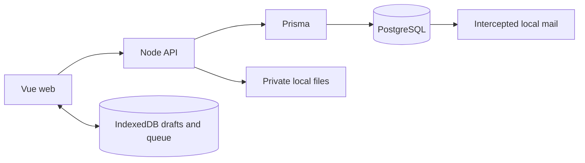

# Working on the Rafik revamp

**Monorepo layout, 16 October 2026:** the Vue app is at the repository root; API, Prisma, canonical backend content and API tests are under `backend/`. The root [university requirements](../../../docs/requirements/README.md) and [architecture proposal](../../../docs/architecture/README.md) supersede the historical gym-first roadmap. Current service/development documentation does not establish production hosting.

## Maintaining experience reports

`FeedbackPage.vue` lists eligible own sources; `RatingForm.vue` handles optional non-defaulted scores and durable drafts/commands. `ExperienceReport.vue` separates client, workplace and renewal views; `TrainerDelivery.vue` adds event-staff delivery counts and a readable table. Session completion links lead to the same feedback service; do not add a second mobile-only rating store. Extend both HTTP authorization tests and the isolated source-to-chart journey when modifying a measure. Use `npm run test:organization-feedback`; web: `npm run test:e2e -- organization-feedback.e2e.ts`. [R21 contract](r21-satisfaction.md) defines exact time windows/denominators.


## Maintaining session packages

Organization packages now track explicit trainee entitlements, derived available/reserved/used balances, validity dates, auditable allowance corrections and linked renewals. Calendar booking reserves only an explicitly selected package; completion consumes present/charged absent sessions, cancellation/excused/released no-shows release, and independent trial/makeup/prize/other sessions never affect allowances. Staff session details include check-in timestamps and durable notes; the overview surfaces missed sessions without a replacement. Reuses workspace transactions/receipts and existing calendar events; no parallel scheduler or payment processor.

Change entitlements in `server/organization-packages.ts` and booking/accounting in `server/organization-calendar.ts`. Web entry points are `OrganizationPackages.vue`, `PackageFunding.vue` and `SessionNote.vue`. Keep derived balances and funding mutations in the same workspace transaction. Extend `tests/organization-packages.test.ts` and the companion `tests/organization-packages.e2e.ts` for lifecycle changes. See [the contract](r20-session-packages.md) and [verification](verification.md).


The current implementation is recorded through R21. Read the [ledger](ledger.md), [architecture](architecture.md), [runbook](runbook.md) and [role audit](role-scope-audit.md). The root docs describe the approved university-first stages. Existing gym/organization features are available locally; university injury workflows and production hosting are not implemented.

## Runtime responsibilities



The database owns transactional domain invariants, revisions, permissions and immutable snapshots. The API owns authentication, transport validation, bounded reads and file bytes. Vue owns interaction and device recovery, never independent server authority. There is one identity system; organizational role/context expansion follows ADR 0005.

## Backend file map

| Path | Responsibility |
|---|---|
| `compose.yaml` | Isolated local PostgreSQL service, loopback ports and persistent volume |
| `prisma.config.ts` | Migration connection and schema location |
| `prisma/schema.prisma` | ORM models, generated client source declaration |
| `prisma/migrations/` | Forward schema, RLS, constraints and transactional command changes |
| `prisma/fixtures/` | Synthetic local identities, history, coaching and business configuration |
| `prisma/seed.sql` | Generated composition of content and fixtures; empty local database only |
| `server/index.ts` | HTTP routing, origins, payload limits and error boundary |
| `server/db.ts` | Prisma instance and transaction-local actor context |
| `server/auth.ts` | Email challenges, opaque sessions, local preview and logout |
| `server/commands.ts` | Granted command registry, bounded reads and focused projections |
| `server/files.ts` / `private-bytes.ts` | Private metadata/permissions, immutable bytes, download and recoverable cleanup |
| `server/generated/` | Ignored generated Prisma client; never edit |
| `tests/sql/` | Seven rollback domain/access/lifecycle suites |
| `tests/api.test.ts` | Actual authentication, pool isolation, transport and file checks |
| `scripts/prisma/local.mjs` | Local start/stop/seed/env/test commands |
| `scripts/prisma/fresh.mjs` | Disposable fresh-schema verification |
| `scripts/prisma/types.ts` | JSON transport types for the web app |
| `scripts/prisma/fixture.mjs` | Guarded local synthetic identity/operator test helpers |
| `scripts/verify-{services,teams}.mjs` | Real HTTP lifecycle/race/access checks |
| `scripts/content.mjs` | Canonical content generation |
| `docs/` | Current engineering references, phase evidence and historical audit |

`npm start` starts/migrates the database; `npm run start:api` runs the API separately. Use the runbook for precise commands. Old runtime source is preserved at backend commit `727f02d`; no legacy services or old data migration are required.

## Web application file map (repository root)

```text
src/App.vue                       authorized staff dashboard/public shell, language/theme controls
src/features/workspace/DashboardNav.vue grouped staff links
src/styles/dashboard.css          desktop workspace/section scrolling and mobile drawer
src/components/TimezonePicker.vue shared Reka searchable IANA picker
src/lib/timezones.ts              catalog, current offsets and city search aliases
src/features/analytics/MetricChart.vue Unovis plots, keyboard/table equivalents
src/app/router.ts                 public/private routes and safe return paths
src/app/auth.ts                   Auth identity and profile loading
src/features/public/             landing, local privacy and not-found page
src/features/account/            login, invitation, settings/export/delete, help/local preview
src/features/training/           Today, public sample, workout logger and history
src/features/coaching/           coach home, roster/client workspace, library, plans and review
src/features/ongoing/
  FormEditor.vue                  reusable check-in/assessment questions, template draft recovery
  RequestsPage.vue                assignment schedule, response queue/history, template links
  ResponsePage.vue                client draft/submission/correction, coach review, comparison
  MessagesPage.vue                participant inbox, paged conversation, context, durable send retry
  ProgressPage.vue                acknowledged exercise trends, current schedule, measurements
  CoachingActivity.vue            actual due/review/unread links on both Today pages
  types.ts                       module data contracts (JSON question/answer shape included)
  helpers.ts                     pure response-state and unit-aware trend calculations
src/features/services/MorePage.vue trainee secondary navigation and retained staff compatibility routes
src/features/nutrition/
  NutritionPage.vue               role-aware guidance, food diary and saved foods
  NutrientFields.vue              optional numeric input with unknown/zero distinction
  model.ts                       typed snapshots and portion-scaled totals
src/features/appointments/
  CalendarPage.vue                offer preview, booking/history, durable command retry
  UpcomingAppointments.vue        next-week read summary on Today
  model.ts                       slot/appointment types and timezone formatting
src/features/resources/
  ResourcesPage.vue              upload/share/download/delete and recovery UI
  files.ts                       authenticated download, byte cleanup and account cleanup
src/features/teams/               list/workspace/invitation, scoped types, explicit pending-command helper
src/features/business/BusinessPage.vue account state/event history and local simulator
src/features/support/SupportPage.vue submitted cases, recoverable draft and response lifecycle
src/components/PageState.vue      common loading/error rendering
src/lib/backend.ts                typed table/RPC entry point, paged record reads, old-host guard
src/lib/database.types.ts         GENERATED SQL schema types
src/lib/domain.ts                 training/program/client domain types
src/lib/prescriptions.ts          schema 1/2 compatibility and target/actual presentation
src/lib/dates.ts                  date-only and timezone utilities
src/lib/storage.ts                IndexedDB stores and account-scoped draft helpers
src/lib/training.ts               workout start/adoption, durable edits, sync, correction/conflict
src/lib/i18n.ts                   bilingual vocabulary, locale and contextual error copy
src/content/sample.json           GENERATED public training sample
src/style.css                    tokens, controls and semantic feature layouts
public/                          local assets/brand; no remote font dependency
scripts/visual-check.mjs           route/width/language/theme overflow checks
scripts/r2-visual-check.mjs        populated ongoing-coaching render and accessibility matrix
scripts/verify-team-layout.ts      populated R4 layout/accessibility matrix; isolated synthetic users
tests/team-fixture.ts              local-only fresh identity setup/cleanup for R4 checks
tests/teams.e2e.ts                 consent/handoff/group lost-ack recovery/business/support UI
tests/*.test.ts                   pure unit/data invariants
tests/*.e2e.ts                    real browser workflows against local PostgreSQL/API
```

Modules use the existing Vue Composition API; there is no new global store layer, chart package, general form-rule engine or repository abstraction. Check-ins and assessments share one small typed question vocabulary because their assignment/submission/review lifecycle is the same. They retain different purposes and separate compatible-result histories. The editor does not support nested rules, branching, uploads or calculated scoring.

## Routes and a useful test tour

Start at `http://127.0.0.1:5173/local-preview`. Choose **Laila Khoury** for the coach or **Amir Hassan** for the client; these buttons sign into real synthetic local accounts. No emailed code is needed. The ordinary login flow sends mail only to `http://127.0.0.1:55324`.

| Task | Coach | Client |
|---|---|---|
| Work queue | `/coach` | `/today` |
| Programming | `/coach/plans`, `/coach/plans/:planId` | assigned workouts from Today |
| Client context/schedule | `/coach/clients/:relationshipId` | Today schedule |
| Exercise catalog | `/coach/exercises` | exercise instructions inside workout |
| Progress | `/coach/clients/:relationshipId/progress` | `/progress` |
| Requests/history | `/coach/checkins` | `/checkins` |
| Template creation/edit | `/coach/forms/new`, `/coach/forms/:formId` | assigned snapshots only |
| Response/review | `/coach/checkins/:requestId` | `/checkins/:requestId` |
| Conversations | `/coach/messages/:relationshipId` | `/messages/:relationshipId` |

**Client workspace URLs use the relationship UUID, not the person's UUID.** The local Laila–Amir relationship is `40000000-0000-4000-8000-000000000001`.

For R2: open the seeded reflection as Amir, save a draft, submit it; switch to Laila and review it from Today; return as Amir and correct an answer. The review clears and the original submitted timestamp stays fixed. Use **Discuss this response** to send a contextual message, then reply from the coach inbox. Create another assessment from the same template revision to compare compatible numeric results. In Progress, record a measurement with **Only me** or share it explicitly with Laila; correct or remove it. The coach only sees shared records.

## Safe local development

For exact commands see [runbook](runbook.md). The web and API share one Git branch; never push main. Node is 22.16.0. Docker must be running. Local API: 55331; database: 55332; mail: `/local/inbox` on the API; dev: 5173; production preview: 5174.

1. Install pinned dependencies with `npm ci` at the repository root and `npm ci` in `backend/`, start the backend, and generate the ignored root environment with `npm run web-env` from `backend/`.
2. **Empty first setup only:** `npm run seed:local`. It refuses a populated preview.
3. **Existing preview:** `npm run db:migrate`, `npm run db:generate`, `npm run types`, then restart the API. Preserve entered notes/invitations/history.
4. Start frontend dev. The default browser test command starts its own disposable stack; preview servers remain necessary for read-only visual sweeps. All tests stay local, never hosting.
5. Use `npm run test:fresh` to validate a clean install in a temporary database without disturbing the preview.

Schema changes go into the next migration. Once a migration has been applied, keep it immutable and add a forward migration; checked-in migrations must reproduce the preview schema. Never apply synthetic Auth seeds to hosting.

## Change recipes

**New UI capability:** locate the task module, describe the user action and states, add only needed routes/components, then add the bounded command and read policy if data changes. Reuse the semantic tokens and bilingual pairs. Do not add signup questions to expose optional features.

**New question type or answer semantics:** update SQL `validate_coaching_fields` and `save_coaching_response`, then `ongoing/types.ts`, editor and response rendering. Test old assigned snapshots. New template revisions apply only to future assignments. Do not mutate assigned `fields` from the frontend.

**Progress metric:** start from acknowledged `set_entries`, include its unit and meaningful denominator, update `training_progress` plus `helpers.ts` and its pure tests. Never convert a missing value into a reported zero or blend strength/time/distance into one score. Current schedule counts describe the current assignment configuration, not historical adherence after arbitrary schedule edits.

**New message feature:** keep send UUID/payload persistence and context ownership checks. Notification delivery is a future adapter; failures there must not roll back or duplicate a message. Attachments use the implemented R3 resource/share contract and authenticated downloads; do not embed arbitrary public upload URLs in message JSON.

**Shared content:** edit `content/starter.json`; run `npm run content` and `content:check`. Generated files are not independent sources. Synthetic R2 examples live in `fixtures-coaching.sql`; keep them out of production data provisioning.

**Schema:** add a migration, run SQL tests and clean-schema verification, regenerate web types, then build/test affected UI. Add a new SQL suite to both `scripts/prisma/local.mjs` and `scripts/prisma/fresh.mjs` if introducing a new suite file. Do not hand-edit generated TypeScript.

## Required finish checklist for every future change

- Update the relevant root `CHANGELOG.md` with the actual behavior/files changed; maintain accurate implemented/partial/deferred status in `ledger.md`.
- Update `architecture.md` for any data, ownership, API, snapshot, retry or lifecycle contract change.
- Update this guide and the affected README when files, modules, setup or development workflow change; update the runbook for operational changes.
- Record executed verification and its limitations in `verification.md`. Do not copy a previous test count as evidence for new code. Preserve evidence under `docs/implementation/evidence/` without secrets or user messages.
- Run the checks appropriate to the change and inspect affected rendered screens in both languages and phone/desktop layouts. Follow the approved university-first stage gates before adding hosting or mobile claims.
- Keep code and matching documentation together on the approved non-main branch. Never label the whole revamp complete just because one phase passes local tests.

## Working on R3

The coach routes are `/coach/more`, `/coach/nutrition`, `/coach/appointments` and `/coach/resources`; clients use the same paths without `/coach`. The nutrition/calendar components share presentation where the task overlaps, with role-specific commands. Authorization always lives in SQL, not route names. `/coach/nutrition?client=<relationship UUID>` and `/coach/appointments?client=<relationship UUID>` provide client context. There are no duplicate coach/client stores.

To change nutrition fields, update migration validation and `nutrition/model.ts`, then the small `NutrientFields.vue` component. Preserve nullable unknown values, explicit basis/units/source and immutable meal snapshots. Do not infer targets or import a provider response directly into a client's history. The local USDA food picker fills an editable draft; it never writes a client's history directly. Expand its canonical content using the content guide.

To change scheduling, start with `r3-contract.md` and `appointments.sql`. Keep UTC instants separate from local date/time inputs, preview DST effects and preserve the sorted participant locks. The calendar's persisted pending command must remain unchanged until acknowledged or definitively rejected. Test two concurrent clients and dual-role participants through `npm run test:services`.

To add a file type or change limits, update the private bucket configuration, registration validation, frontend `fileTypes`, accepted input/help copy and service tests together. A resource is usable only after finalization. Never add an overwrite API to change bytes under existing message attachments. Upload a new resource instead. Keep deletion in `files.ts` as retire → byte removal → metadata remove. Account deletion reuses that function. Exported JSON contains metadata; downloads are separate authenticated byte requests.

Run `npm run test:services` from the backend for real identity/commands/files integration; it creates and deletes only temporary synthetic accounts. The disposable database test applies the same Prisma migrations and synthetic seed to a new database. It does not copy preview records or physical file bytes. `scripts/r3-visual-check.mjs` in the frontend checks eight role/routes × four widths × two languages × two themes and saves local artifacts. Screenshots and local test logs are ignored, while repeatable checks and results are documented.

Current R3 gaps belong in the ledger: no team ownership, real calendar/reminder provider, large/multipart upload, file scanning or hosted deployment. R4 should extend explicit person/relationship ownership deliberately; it must not expose every private client record just because two coaches join a team.

## Working on R4 safely

1. Read `r4-contract.md` before changing roles, handoff or commercial behavior. Team membership never grants all client data. Add an explicit workflow for any broader sharing; do not relax participant reads.
2. Add new staff roles only if a concrete job cannot be expressed by owner/admin/coach. There is no configurable role builder. Teams are optional; keep solo clients/coaches out of setup forms.
3. Group UI lives in `TeamPage.vue`; persistence is `save_team_group`/`archive_team_group`/`set_team_group_client`, assignment is `assign_team_group`. Keep explicit selection and one transaction/receipt. Do not call assignment repeatedly from a browser loop.
4. Shared plan import must preserve its independent exercise copies. A shared snapshot is not a live reference to a colleague's editable draft. Team file grants stay separate from client relationship shares; use the Resources owner audience list to revoke even after departure.
5. Local commercial defaults live in `business_accounts`; the internal simulator flag lives in `runtime_settings`. Never expose service-role credentials or call provider commands directly from the browser. Changes to provider state must leave training/history usable. Test duplicate, stale and unauthorized events with `npm run test:teams`.
6. R4 screens use one persisted pending command with a stable ID/payload. On reload, show retry even if the last command closed a team or removed the current member. Never silently discard an uncertain command. New mutation functions need a documented exact-retry path.
7. After schema changes, run `npm test`, `npm run test:fresh`, `npm run test:services`, `npm run test:teams`, API type checking and `npm run types`. Then run web unit/build/format checks and full browser scenarios; `test:teams:layout` verifies R4 rendering. Fresh/test fixture accounts are temporary and cleaned up; do not turn these helpers into deployment seeds.

### R4 manual tour

Use separate browser profiles for Laila, Nour and Amir. At `/local-preview`, choose Laila → Teams → create team → Staff → invite `coach2@rafik.test`. Open the link in Nour's profile and accept. As Laila, Clients → choose Amir → request enrollment; Amir sees a Today link and approves in `/teams`. Laila creates a group, adds Amir, selects Amir explicitly, selects a published version and reviews/confirms assignment. Shared library → share a published plan; Nour copies it and can edit/publish independently. Upload files in Resources, then explicitly share them in the team library.

Laila proposes Nour as Amir's new coach; Amir approves with the consequences displayed. Nour can now open the direct coaching workspace. Laila retains her original participant history; Nour cannot read that private history. Team subscription → Local provider simulation can set past due and restore active. Existing workouts stay available. Client Support → choose team → submit a request; team owner/admin responds in Support. Platform support response has separate operator authority through Platform Operations; the guarded local CLI is also documented in the runbook.

Team Activity includes rename and owner closure; Staff includes ownership transfer/departure. Group archive removes only its grouping, not assigned plans. These are real local mutations: use clearly named test teams when exploring and close their enrollments/team when finished. No team fixtures are imposed on the existing Laila/Amir preview.

## Engineering handoff and R5 change recipe

Start at [docs/README](../README.md), then [CONTRIBUTING](../../CONTRIBUTING.md); use ADRs for lasting decisions and the architecture/API reference for current contracts. `scripts/check-docs.mjs` checks maintained local documentation links (`npm run test:docs`); historical audit links are deliberately excluded because they reference baseline commits.

When changing exercise choice, touch all relevant layers: SQL validator/snapshot/save/copy/projections in migration 009; `domain.ts` shape; `prescriptions.ts` actual-identity helper; plan editor; workout logger; review; progress/previous-performance; rollback and browser scenarios. Choices travel inside the existing Entry array and durable operation. Do not add a second synchronization channel or mutate `Session.prescription`.

`tests/product-quality.e2e.ts` creates disposable identities with the existing `team-fixture.ts` helper for long-message and exercise-choice journeys. It tests observable composer geometry/focus/read state and blocked-save recovery, rather than only route existence. Existing suites retain dropped-acknowledgement, permissions, lifecycle and actual Storage checks.

Messages layout rules are scoped in `style.css`; changing shared shell sizing requires desktop/phone/RTL/theme inspection plus the full browser suite. Lists currently use complete authorized reads with bounded rendering; do not describe that as server-side pagination or infinite-scale performance.

`npm run test:quality:layout` in the frontend runs the focused 128-layout English/Arabic/theme/width matrix, including an explicit composer-in-viewport assertion. Inspect its ignored `artifacts/r5-final-*` screenshots; metrics alone do not establish usability.

## R6 maintenance and release recipe

- Responsive geometry: `tests/layout-contract.ts` detects document overflow and internal clipping; `tests/responsive-inbox.e2e.ts` uses fresh long-name multi-contact fixtures, short/tall/landscape/resized viewports and both engines. `scripts/audit-product.ts` is the broad client/coach route audit (`npm run test:product:layout`). The team layout script also uses the shared checker and runs in both Chromium and WebKit; reports are `artifacts/r4-layout.json` and `artifacts/r6-team-webkit.json`. Capture the actual loaded data surface and inspect screenshots; single page-height or selected-detail coverage is insufficient.
- Inbox CSS: remove obsolete flex-basis/direction rules; the phone grid and inbox must have zero minimum width, contact rows intrinsic height, and vertical scrolling bounded by the workspace. Native select text must stay inside the input in Safari/RTL. Roster renders twelve clients at a time; search/status operates over all loaded authorized rows and resets the visible count.
- Offline updates: `build/offline-shell.ts` hashes contents and generates the worker; `src/app/updates.ts` registers/checks it; `src/components/AppUpdates.vue` provides shared Help/Settings UI. `npm run test:build` checks final emitted files and two HTML-only builds; worker generation must run after all bundler transforms. `tests/app-updates.e2e.ts` serves a real production bundle under two release identities plus a failed installation, preserving actual IndexedDB work across activation and offline reload. Never add `skipWaiting` or automatic reload without a new cross-tab/draft contract.
- Release gate: from backend, `npm run verify:release -- --check` validates prerequisites; `npm run verify:release -- --full` runs the complete local chain serially. See the runbook for reports and recovery. `npm run test:release` checks rejection of remote/wrong-project/main/wrong-runtime prerequisites. New scripts must never print local service credentials.

## Daily workspace maintenance (R7)

`src/features/workspace/WorkspaceNav.vue` owns role-specific primary/secondary links, `types.ts` describes attention rows, and `src/styles/workspace.css` owns the compact shell and daily layouts. `CoachHome.vue` composes the attention projection and upcoming appointments; `TodayPage.vue` uses `client_today`; `ClientsPage.vue` uses cursor-based `coach_roster`. Extend these read contracts through a new forward migration (migration 010 records the original contract), regenerate types, and run `daily_workspace.sql` plus `tests/workspace.e2e.ts`. Staff use DashboardNav on desktop and in the phone drawer; keep WorkspaceNav/More aligned for trainee routes.

## Working on organization contexts

Read [R7A2](r7a2-contract.md). API logic is `server/workspaces.ts`; membership schema/lifecycle is in Prisma migrations 130–150. Never infer a global coach/admin grant from an organization role. Add domain operations behind `scoped`/`mutation`, passing the explicit organization ID and required fixed role, and validate related membership IDs in that same organization. Receipts must not bypass revocation. The database login for ORM organization tables is API-internal; no generic browser table grant is added.

Web views/types/styles live in `src/features/organizations/`. `auth.ts` fetches valid contexts; the shell renders them. Draft and pending keys include account, organization and role. `tests/workspaces.test.ts` exercises HTTP access/lifecycle; web `tests/organizations.e2e.ts` exercises actual invitation/assignment/recovery/revocation. Add new checks to the serial release runner. Current organization membership names are scoped snapshots, separate from a person's independent profile.

## Programming changes (R8)

- Shared editor/library transport: web `src/features/coaching/program-context.ts`. Keep independent and organization authorization on the server; the adapter only supplies context and normalizes transport.
- Safe reuse: `program-structure.ts` plus its unit test. Copies allocate new day/exercise keys and schedule positions, preserving the source. Do not change started prescriptions when editing a draft.
- Reviewed delivery: `DeliverPlan.vue`; its pending command contains the confirmed recipient IDs/revisions and schedule. A refresh must not replace that pending payload with a newly loaded selection.
- Organization navigation/training: `OrganizationNav.vue`, `OrganizationTraining.vue`; existing `PlanEditor`, `ExercisesPage`, `ReviewPage` and the durable workout logger are reused. Every draft/command includes account/context.
- Server: `server/programming.ts`, organization models/migrations, `tests/programming.test.ts`. Before adding a mutation, define both current-role and subject authorization, including before receipt replay after a staff change. Extend `tests/programming.e2e.ts` for the complete human-visible flow.

## Calendar, assessments and analytics changes (R9)

`server/organization-catalog.ts` owns reusable group/template writes; `organization-calendar.ts` owns agenda/attendance/results; `service-definitions.ts` validates bounded drills and numeric values; `analytics.ts` owns role-specific projections. Migrations 240/250 define service tables, profile-lock collision checks and the explicit API preview grant. Keep API-only tables out of generic browser row grants. Subject export lives in `account-data.ts`.

Web `ServiceCatalog`, `EventComposer`, `OrganizationCalendar`, `EventDetail`, `AssessmentHistory` and `OrganizationUpcoming` form the complete workflow. `analytics/AnalyticsPage` and `MetricChart` share truthful charts and table equivalents. For a new drill kind, update validation, immutable snapshot, result editor, correction/history, comparison compatibility and tests together. Never combine incompatible units/definitions into one line. Add acceptance to `test:organization-services` and `organization-services.e2e.ts`; `audit-services.ts` checks rendered roles/states.

Local tour: Rania → Calendar → Schedule; Library → Assessment templates or Groups. Kareem → Calendar → completed Movement baseline → review Sara's distinct result; Training → Assessment history shows synthetic 10/12 repetition examples. Rania Analytics shows organization responsibility/attendance; Kareem Analytics contains only current assigned-trainee scope. A designated assessor can record an event even when another trainer normally owns responsibility.

## Communication ownership

Backend `server/organization-communication.ts` owns channel commands and reads; `server/notifications.ts` owns current audience, preferences, generic links and local dispatch. Forward migrations 260–290 contain their schema and capture/reminder functions. The matching web modules are `features/organizations/{ChannelsPage,ChannelThread,ChannelEditor}.vue` and `features/notifications/`. Reuse `useCommand` for uncertain writes; do not hand-roll a second pending queue. Run `test:communication`, the browser communication journey and `scripts/audit-communication.ts` for changes here.

## Operations, roster paging and ordinary change rehearsal (R11)

| Owner | Files / contract |
|---|---|
| Platform | Backend `server/platform.ts`, migration 300; web `features/platform/PlatformPage.vue`; grant checks before receipt lookup |
| People/recipients | Backend `server/people.ts`; shared web `organizations/MemberPicker.vue`, `coaching/DeliverPlan.vue`; bounded search plus selected IDs |
| Summary/history | `workspaces.ts`, `programming.ts`, `organization-calendar.ts`, `analytics.ts`; preserve full-scope totals, page breakdowns |
| Test isolation | Web `scripts/isolated-browser.mjs`, `tests/local-config.ts`; backend guarded test database/files configuration |
| Recovery | `scripts/prisma/recovery.mjs`, `cleanup-private.mjs`; private local archives and grace-period report/apply |

An ordinary UI change rehearsed in R11 replaced raw audit operation keys with bilingual action labels and grouped analytics continuation controls with their charts. Edit the owning feature, preserve pending-command behavior, run web type/unit/build, then the operations browser journey and `test:operations:layout`. Inspect real phone/RTL captures; a passing type check does not establish readable labels.

A domain change rehearsed in R11 added the roster order index and paginated result history: first inspect query plans and define continuation/scope, add a forward migration for the index, apply/introspect/generate/types, implement bounded reads, then verify scale and cross-trainee history access with real HTTP tests. Update the consumer with explicit load-more and current selection retention. Do not edit historical migrations or introduce a second data store. The local before/after query plan and the 29-revision participant test make this recipe reproducible; an independent engineer has not yet validated this handoff.

Keep new tests test-owned and cleanup bounded. Use `set -e` for dependent shell checks so a failed type check cannot be hidden by a later successful command. Run complete browser suites through the isolation wrapper; stop editing sources during the accepted run. Keep current architecture/API docs separate from historical phase totals.

## Connected product entry and setup (R12)

`features/public/HomePage.vue` owns the coach/organization positioning and keeps the workout sample available. `account/LocalPreview.vue` groups synthetic roles; `account/HelpPage.vue` explains actual scope. These are presentation owners, not authorization logic. `EventComposer.vue` owns optional catalog/group disclosure, retained selections and step focus; `ChannelsPage.vue` changes page sizing only while creating, preserving the thread workspace.

Before reordering landing sections, inspect spacing that formerly came from adjacent sections. When moving a form inside a viewport-sized workspace, verify both its initial and completed states with natural page scrolling and reachable actions. Preserve selected identities when replacing search results; disable review until their names/authority-dependent eligibility resolve. Use latest-request guards when independent search/filter requests can finish out of order. `cohesion.e2e.ts` and `audit-cohesion.ts` cover the connected entry/help review alongside operations/service tests.

Selecting an already loaded member is a local selection change: keep the current result page and resolve its name from authorized loaded rows. Fetch separately only when a restored/bulk selection includes unknown IDs. The server still rechecks authority/revisions at commit. Deduplicate appended catalogs by stable ID. The large-member browser scenario now verifies that selecting row50 keeps all50 loaded choices before search/reload.

Shared test helpers that run under both Playwright and direct Node type stripping use explicit local `.ts` imports. The web compiler allows those imports under `noEmit`; Vite's config follows the same convention. Verify direct script entry points as well as transformed test imports. Do not resolve a module failure by skipping the layout gate.

## Dashboard component changes (R13)

Keep shell geometry in `dashboard.css` and feature layout in its own component. Staff links belong in `DashboardNav.vue`; `WorkspaceNav`/`OrganizationNav` remain for trainee/public-compatible surfaces. Do not add dashboard links to an invisible legacy navigation component. Verify the authorized context and selected state on deep links, Settings/Notifications, back navigation and workspace changes.

Reuse `TimezonePicker` for every timezone editor: `v-model` is the selected IANA value, `label` supplies its accessible name, and `disabled` must follow the command/editor lock. Search text is temporary and must never become a saved value. Do not reintroduce a short datalist or free-text timezone field. `MetricChart` accepts semantic items and an optional timeline/donut/counts mode; `counts` is appropriate for session/people counts, not general assessment measurements. Category pagination is presentational; server read cursors remain owned by AnalyticsPage.

Run `tests/dashboard.e2e.ts` for saved selection, keyboard/escape, drawer focus, chart tabs/filters/failure retention and viewport scrolling, then `npm run test:dashboard:layout` for role/theme/language/breakpoint renders. The latter reads local sample accounts without synthetic writes. Final release includes both this matrix and the existing journey/layout suites. Dependency upgrades must inspect open portals and all chart variants, not just compile the wrappers.

Workspace Back restoration waits for asynchronous content to support the saved offset and cancels on new navigation or user input. Keep this behavior covered when changing loading states or page structure.

## R14 file map and change recipes

| Owner | Files and responsibility |
|---|---|
| Reference content | `content/foods.json`, `content/exercise-media.json`, `content/exercise-media/`, `content/upstream/`; source values, rights and immutable bytes |
| Content tooling | `scripts/content.mjs`, `scripts/content/exercise-media.mjs`, `scripts/content/extract-usda-foods.sh`; reproducible generation/verification |
| Public API | `server/public-catalog.ts`, catalog routes in `server/index.ts`; reference-only reads and digest-verified SVG serving |
| Nutrition persistence | migrations `202609231500_nutrition_meal_plans`; immutable bounded suggested foods and compatible command default |
| Exercise reference persistence | migrations `202609231510_exercise_media`, `202609231520_media_reference_commands`; keys, validation and plan-copy retention |
| Web nutrition | `src/features/nutrition/{NutritionPage,MacroPlanner,MealPlanEditor,FoodPicker,NutrientFields}.vue`, `model.ts`, `src/styles/nutrition.css`; scoped drafts, command recovery, explicit targets and portions |
| Shared exercise presentation | `src/components/ExerciseDemo.vue`; library/editor/routine/logger consumers, explicit motion and fallback |
| Acceptance | backend `tests/public-catalog.test.ts`, SQL service/exercise suites; web `tests/nutrition-planning.e2e.ts`, `tests/exercise-media.e2e.ts`, nutrient units |

Food lookup is now a small local source-backed catalog. Expand it through the content guide, not by embedding provider calls in components. Adding organization nutrition requires separate ownership, assignment and sharing contracts first. To change portion math, cover unknown versus zero, source calorie differences and independent suggestion/actual snapshots. To change helper forms, test abandoned invalid helper values while saving a valid parent plan. To change drafts, test client/date/visibility switches and uncertain responses after reload.

### Exercise catalog workflow (R15)

Read the [content guide](content.md) and [ADR0011](../decisions/0011-exercise-catalog-and-motion.md) before changing imported content. `source_ref` is server-owned provenance; copy functions must retain it for both primary exercises and alternatives. `media_ref` is a separate immutable asset key. Do not infer a video mapping from similar names or copy source text without its own license.

The web library lives in `features/coaching/ExercisesPage.vue`. It filters the authorized corpus, renders 24 results per page, and opens one detail view; mobile returns focus to the selected result. `components/ExercisePicker.vue` renders at most 40 matches and is used for primary and alternative selection. Do not replace it with thousands of native options/checklists. `ExerciseDemo.vue` resolves source credits and the available media type; `ExerciseVideo.vue` owns visible playback/reduced-motion/error lifecycle. `lib/exercise-catalog.ts` holds bilingual facet labels and equipment aliases. Update these together when introducing a facet or media type.

Acceptance includes later-page search and selection, compound category filters, newly saved custom categories, selected-value retention, same-kind alternatives, immutable published/copied references, actual video playback, 206/416 ranges, failure/retry, phone list/back navigation, RTL/themes and both browser engines. Inspect captures; content volume and a green test count do not establish useful movement guidance.

Portaled Reka content must receive locale direction explicitly unless a verified global ConfigProvider supplies it. `ComboboxRoot` direction alone does not set Popper Content direction. Check the open popup’s computed direction, visible option bounds and mixed-language text in a viewport screenshot. Keep optional filters collapsed initially and give the popup one scroll owner.

## Organization nutrition maintenance (R16)

Start with [ADR0012](../decisions/0012-organization-nutrition.md) and [R16 contract](r16-contract.md). The server module owns authorization, bounded reads, optimistic revision checks and transactional commands. Keep `authorize` checks before the mutation receipt; never substitute an independent relationship for membership. Reuse SQL nutrition validators and preserve immutable plan/food source values. Do not broaden profile grants for local dates: the server-only date helper provides exactly that projection.

The web page owns context selection, view switching and durable drafts; `OrganizationMealFields.vue` owns actual portion/source controls. `MacroPlanner` already renders target fields, so do not wrap it with a duplicate `NutrientFields`. `MealPlanEditor` is suggestion-only. Navigation belongs in both organization navigation and dashboard navigation, plus roster links and Help. The desktop panel fills remaining workspace height; phone form scrolling stays natural.

Changes must cover independent nutrition regression as well as organization author/subject/staff views. Exercise consent withdrawal, current-trainer changes, revoked receipt replay, source density versus actual amount, removal history, stale revisions, closed draft resumption and lost acknowledgements. Add API scenarios to `tests/organization-nutrition.test.ts` and UI cases to the companion `tests/organization-nutrition.e2e.ts`; both are in normal local acceptance/CI configuration.

## R17 presentation owners

- Web `src/styles/utilities.css` and `vite.config.ts`: additive prefixed Tailwind (no Preflight). Existing theme tokens/CSS stay authoritative.
- `App.vue`: staff context selection, dark default and messaging-scope router identity. Changing route identity requires independent and organization inbox/uncertain-send regression.
- `features/ongoing/MessagesPage.vue` / `MessageThread.vue`: persistent inbox versus keyed thread; organization counterparts are `ChannelsPage.vue` / `ChannelThread.vue`.
- `components/MonthCalendar.vue`, `features/organizations/OrganizationCalendar.vue`: month projection/day selection over the same calendar API. Do not interpret a loaded page as the complete monthly total.
- `tests/gym-direction.e2e.ts` plus responsive inbox, daily coaching, organization nutrition, programming and service journeys cover this change. See verification for executed counts and limitations.

### Organization exercises and resources (R18)

Exercise metadata lives in `organization_exercises.data`; keep singular category/equipment fields for older consumers and arrays for multi-selection. `ExercisePicker.vue` and `ExercisesPage.vue` use `exerciseAreas` and `equipmentCategories`; do not filter only the primary category. `MultiChoice.vue` provides searchable native checkbox selection without modifier keys. `OrganizationUpload.vue` uses a digest-keyed pending upload ID; `OrganizationAsset.vue` loads authenticated blobs, cancels stale reads and revokes browser object URLs. `OrganizationResources.vue` owns paginated search and archive/restore; exercise creation can reuse that same registry. The shared `ExerciseDemo.vue` makes uploaded media visible in published plan previews as well as the library.

Files use API authorization rather than public URLs. Never expose message-purpose assets in Resources. Update `scripts/prisma/recovery.mjs`, `cleanup-private.mjs` and scoped test teardown whenever a new private-file owner is added. Run `test:organization-assets`, communication/programming/operations, fresh-install and the corresponding browser journeys. See [ADR0013](../decisions/0013-organization-exercise-media.md).

### Staff tasks and overview (R19)

`server/organization-tasks.ts` owns task commands, scoped list/counts and derived follow-up queues. `OrganizationTasks.vue` owns admin authoring, trainer actions, search/history and durable device drafts; `OrganizationFollowUp.vue` displays the same authorized task read plus session/assignment/calendar queues. Task completion is unrelated to session completion or billing. Keep action links aligned with the relevant role routes; never infer a no-show, medical risk or satisfaction score from inactivity. Run `test:organization-tasks` and `tests/organization-tasks.e2e.ts`, plus overview and existing calendar/organization regression.
