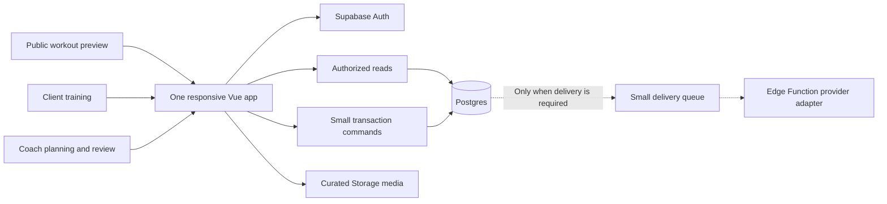

# Clean-rebuild architecture

**Decision updated 22 September 2026: local first, `codex/revamp` branches only, mobile last.** The founder confirms the old product is inactive and legacy user data is not a revival requirement. Build a new product against a new Supabase project. Do not spend the revamp budget restoring the old application, backfilling its records, preserving installed-client compatibility or progressively removing its triggers. The filename is retained for existing links; this is now a replacement architecture, not a migration program.

The [live audit](/Users/sami/Developer/GitHub/rafik-api/docs/revival/06-live-backend-audit.md) remains useful evidence of mistakes to avoid. The [execution runbook](/Users/sami/Developer/GitHub/rafik-api/docs/revival/07-agent-execution-plan.md) is the implementation sequence I will follow.

## 1. What the old architecture teaches us

| Observed design | Result | Rule for the new product |
|---|---|---|
| Different tables use “client ID” for different entities | Follow-up lookup/insertion mismatch; difficult joins and ownership | One Auth-linked person identity; name every other ID by its actual domain |
| Business rules run on broad table updates | Updating an assignment deletes unfinished workouts; editing completed notes replays progression | Explicit commands for meaningful transitions; no unrelated side effects on ordinary edits |
| Mutable plan JSON also acts as workout history | Current prescription, progression and performed activity become entangled | Version published prescriptions; snapshot a session at start; record actual results separately |
| Screen mounting creates profiles/activity and alters counters | Visiting a screen can appear to make progress or create duplicates | Screens read state; explicit start/finish actions change it |
| Client and worker perform multi-request operations | Partial failure, races and inconsistent retry behavior | One transaction per business operation; stable operation IDs |
| Follow-ups are generated indefinitely | 2,182 pending forms and a message count dominated by automation | Do not build forms by default; if needed, one due item per period with an explicit lifecycle |
| Four repos plus untracked DB behavior and external integrations | Ordinary changes require understanding several inconsistent implementations | Two active source roots, one web product, one Supabase backend and only necessary providers |

This evidence does not justify reproducing the old platform with renamed tables. It supports a smaller domain and a complete interaction redesign.

## 2. Target deployment and stack

Default to a **new Vue 3 + TypeScript responsive application and a new Supabase project**. Vue remains a suitable tool; retaining it does not mean retaining the old routes, screens, stores or data model. Start from a clean application scaffold and import an old component only when it meets the new brief and is cheaper to understand than replace.

One responsive web app serves public previews, client training and coach work. This removes the installation barrier and avoids two simultaneous frontend rebuilds. Test actual iPhone/Android keyboard, interruption, durable storage and reconnect behavior early. Mobile-app work is explicitly deferred until the web and backend are revamped and ready. Only then assess whether a new native client adds value. There is no requirement to keep the old app working with the new backend, and no Flutter repair or native prototype belongs in the current phase.



There is no separate custom API service for ordinary CRUD, no Cloudflare worker carried over automatically, no DigitalOcean embedding service and no Firebase dependency in the web core. Supabase handles Auth, database and files; small Edge Functions handle only operations that need server secrets or external services. SQL owns atomic data changes. Simple reads remain direct through tested policies.

Do not provision scheduling just because the old product had it. Shared invitation links and contextual coach review work without a reminder engine. If an actual delivery/reminder requirement appears, use one small queue and one dispatcher, with a single Supabase Cron schedule if needed. Cron is an optional target capability, not a claim about the old project, which has none. [Supabase Cron](https://supabase.com/docs/guides/cron).

## 3. Two active source roots, repeatable setup

Use the provided frontend and API repositories on `codex/revamp`; the worker and mobile repositories remain references. All four branches have been created from their current checkouts. Never push revamp changes to `main`. Keep implementation and testing local for now; no new hosted project is needed during analysis or local development.

```text
RAFIK-FRONTEND/              Fresh application on codex/revamp
  src/app/                  Router, session adapter, shell
  src/features/public/      Offer and routine preview
  src/features/training/    Start, log, resume, finish, history
  src/features/coaching/    Clients, editor, assignment, review
  src/features/account/     Authentication, preferences, help
  src/components/           Shared controls used by those features
  src/lib/                  Narrow data/storage utilities
  tests/                    Core browser and durability cases

rafik-api/                  Fresh backend on codex/revamp
  supabase/config.toml      Explicit new local project identity
  supabase/migrations/      New schema, constraints, commands, policies
  supabase/functions/       Necessary privileged/provider adapters only
  supabase/tests/           Transition and access cases
  supabase/seed.sql         Synthetic scenarios
  docs/                     Audit, contracts, setup, release and recovery
```

Replace legacy source on these branches as implementation proceeds; Git retains its history. Do not create a repository-consolidation project first. Use ordinary scripts, dependency locks, a supported pinned Node runtime and a short cross-repository runbook. Generated database types come from the new migrations. No monorepo orchestration, generic repository factory or shared cross-language UI framework is needed.

Keep UI state local where possible. One session adapter owns authentication; feature modules own drafts/loading/errors; a durable-storage adapter owns unsynced workouts. Global stores must not become the new home of every query, business rule and alert. New local environment guards must prevent commands from accidentally targeting the old linked remote.

## 4. Minimum core data model

These are proposed physical boundaries for E02 to finalize, not a promise to build general teams, billing or organizations. Use Auth UUIDs directly for people in the new system. Other entities have their own clearly typed IDs. No mapping layer to old bigint identities is required.

| Record | Purpose and invariant |
|---|---|
| `profiles` | One row per Auth user, with display name, locale, units and timezone; no second competing person record |
| `coach_clients` | One explicit coach/client relationship; a simple owner model, no workspace hierarchy; state distinguishes invited/active/archived |
| `invitations` | Intended relationship and plan, hashed token, expiry and acceptance state; accepted once by a verified intended identity |
| `exercises` | Small curated movement/media catalog with equipment, localized names and provenance |
| `plans` | Coach-owned editable draft with validated prescription JSON and draft version; public examples are explicitly published |
| `plan_versions` | Immutable published prescription, schema version, author and publication time |
| `assignments` | Client relationship, published revision, start/schedule/timezone and state; changing the future does not rewrite existing sessions |
| `sessions` | Stable logical occurrence, prescription snapshot, start/completion and sync version; optional client note and one coach review can live here initially |
| `set_entries` | Stable session/exercise-instance/set identity, actual quantities and units, operation/version metadata |

Do not create separate organization, group, credit, nutrition, assessment, chat, AI, ticket or billing tables in the first product. A delivery-outbox table is justified only when reliable asynchronous mail/reminders are implemented. New ordinary support can use one existing channel.

Keep the prescription tree as schema-validated versioned JSON because days/exercises/sets are naturally edited together. Normalize actual set entries because they need independent saves, retries and reporting. Do not create dozens of tables for prescription options before the chosen workout format needs them.

Define session identity by assignment plus a logical scheduled occurrence or a generated explicit ad-hoc occurrence. A unique `(client,date)` constraint would incorrectly prevent two legitimate workouts in one day. Week numbering comes from that assignment's schedule. Record UTC timestamps alongside the relevant local logical day/timezone; rest, skipped, missed and completed are distinct states.

## 5. Explicit operations and state transitions

Use named PostgreSQL operations for transactional domain changes. A thin Edge Function can authenticate and call one when it needs provider orchestration; it must not reimplement the SQL rule. Simple draft changes can remain version-checked writes. Test authorization at the actual data/command boundary. [Supabase access model](https://supabase.com/docs/guides/database/postgres/row-level-security).

| Operation | Atomic result and retry behavior |
|---|---|
| `createInvitation` | Save intended relationship/assignment context; stable request key; return one shareable link without sending through multiple channels |
| `acceptInvitation` | Validate intended verified identity, token and expiry; activate relationship/assignment in one transaction; repeated acceptance returns existing result |
| `publishPlan` | Validate draft and expected version; create immutable prescription revision; no automatic edits to past sessions |
| `assignPlan` | Validate coach/client relationship; create the intended future schedule under one explicit overlap rule |
| `startSession` | Authorize occurrence; create its snapshot once; concurrent starts return the same session |
| `recordSet` | Validate session, exercise instance, units and expected version; reuse operation ID on retry; reject stale conflict |
| `completeSession` | Transition from in-progress to complete once; attach result summary; no automatic prescription rewrite or repeated notification |
| `reviewSession` | Save coach review of a real result; explicit future plan adjustment is a separate operation |
| `deleteMyAccount` | Verify caller and handle new-system data/files with truthful status; never trust a submitted arbitrary user ID |

Do not automatically progress weights in the first version. Show prior actual results and let the coach publish deliberate future changes. This removes a hidden behavior with questionable consistency while preserving the useful training task.

Use constraints for referential integrity, uniqueness and simple invariants. Do not carry over the 27 orchestration triggers. A small timestamp trigger is different from a trigger that deletes workouts, rewrites plans and sends notifications.

Return stable failure categories—unauthenticated, forbidden, invalid, conflict, unavailable—and map them to task-specific recovery. UI success must follow acknowledged durable storage, not a fulfilled promise whose error was swallowed.

## 6. Durable workout recording without a general sync platform

Persist the active prescription snapshot and set entries locally before showing them as saved. Queue only workout operations, tagged by account/session and operation ID. Reconnect reuses those IDs, applies bounded retry and displays unresolved errors. Do not attempt full offline synchronization of every feature.

A guest can try a sample with local persistence. Explain local-only storage before relying on it for future history, and offer account saving when it creates value. Do not promise survival after clearing browser storage. If local storage fails, do not show a saved state.

Keep one active editing device per session as the initial policy. Use version checks to detect a second device or stale tab; preserve the local draft and offer an explicit reload/recovery choice instead of silently merging conflicting quantities. Account switching cannot send pending work under the wrong identity. If web-device tests fail, resolve or explicitly narrow that web requirement first. Native work remains a later phase after the rest of the product is ready.

## 7. Authentication, media and delivery

Choose one email verification path for private invitations. Prefer a short email-code flow if it passes actual-device and delivery tests; support a deliberate callback/recovery route for any link-based path. Do not stack registration, confirmation, login and profile completion. Email is a contact channel, not the relational identity. Public routine preview and sample use remain outside the account wall.

Configure Auth email delivery for the new project when deploying, and test it independently of business notifications. Use correct callback/redirect construction rather than appending a route to an already-generated verification URL. Document configuration alongside migrations so it is reproducible.

Start with curated public exercise media and program artwork. Do not add certificate, health-document or AI uploads without a retained task that needs them. If private uploads become necessary, give them separate access/lifecycle rules. Copy only selected reusable content with known rights and verified links; do not transfer the whole old bucket.

If reminders earn a place, create each logical event once, respect timezone/preferences, process overdue items and bound each run. Record provider success/retry/error. External delivery is at-least-once in general; do not promise exactly-once email or push. No daily job should fabricate activity or repeatedly create unanswered forms.

## 8. New environment and launch, without a legacy migration program

| Step | Work I will do | Done when |
|---|---|---|
| New local foundation | Initialize a clean schema and synthetic fixtures | New checkout can reset, type-check, build and exercise core transactions |
| New Supabase project | Create/configure a distinct project when the deployable core needs hosting; use current account access and available suitable capacity | Ref/name/region/environment recorded; new app cannot accidentally point at `pexviywnztvqomfosvho` |
| Curated content seed | Select a small useful exercise/plan set or author synthetic starter content | Units, prescription validity, rights and EN/AR presentation checked; no old user histories imported |
| Staging verification | Deploy the new app with controlled accounts and outbound test recipients | Core tasks, device durability, access, callbacks and recovery pass |
| Launch | Publish the new experience and route new users to it | Clear entry, working monitoring/support and repeatable rollback to the previous **new-system** release |
| Old-system retirement | Inventory only the live resources necessary to stop old automation/costs; prepare the concrete shutdown steps | Old jobs/providers can be disabled without affecting the new product; no ongoing compatibility project |

Leaving the old project untouched during construction is enough to avoid unnecessary deletion work. Its audit snapshot is a reference, not a foundation to restore. The user has authorized creating a new Supabase project; actual provisioning is deferred until implementation needs it, not until legacy data is reconciled. Any unexpected paid-capacity constraint should be handled at that concrete point, without delaying local implementation.

Once the new system begins receiving real use, give **its** data an appropriate backup/restore procedure and rehearse it. That is normal operation of the new product, not a justification for migrating the dead one.

## 9. Make routine updates predictable

| Change | Expected edit surface | Necessary check |
|---|---|---|
| Button style, spacing or typography | Shared token/control | Core phone/desktop and Arabic states |
| Public offer/copy | Public feature content/locale | No layout overflow; clear action and honest claims |
| New prescription option | Versioned schema, editor and logger rendering | Old new-system plan versions still render; values/units correct |
| Change completion/review behavior | One command plus its focused UI state | Transition, retry and conflict cases |
| Reminder timing, if implemented | One eligibility rule | Timezone, overdue and duplicate-run cases |
| Provider change | One adapter/configuration | Failure/retry and controlled delivery |
| Add a coach review field | Session review schema and one feature | Authorization, draft/save and real result presentation |

Judge maintainability with a real small change during release rehearsal: edit, test, deploy and explain all touched surfaces. A clean directory tree is not proof that updates are easy. Keep short decision records for irreversible or expensive choices; do not invent a governance system around routine UI work.
