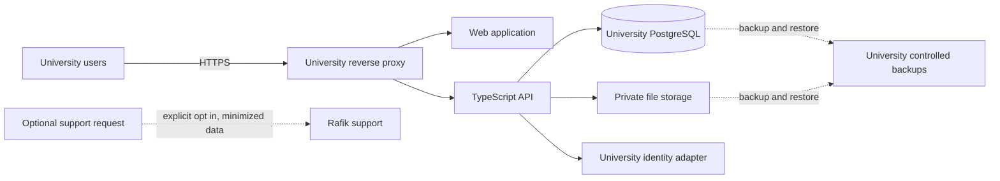

# Architecture overview

**Status:** target architecture proposal, 16 October 2026. The target deployment is not implemented.

## Current components

- The repository root contains a Vue 3/TypeScript single-page application built with Vite. Feature modules cover training, coaching, organizations, assessments, communication, resources, nutrition, appointments, analytics, and account flows.
- `../backend/` contains the TypeScript API with Prisma and PostgreSQL. It owns identity/session handling, domain authorization, database migrations, and private-file access.
- The browser calls the API; domain writes use API commands and reads use scoped API endpoints. PostgreSQL is the durable server store. Browser IndexedDB supports recoverable drafts and workout recording; it is not a backup.
- `backend/compose.yaml` starts PostgreSQL only for local development. The web app and API are started separately. Production hosting remains deferred in `backend/docs/implementation/runbook.md`.

## Target deployment boundary

Each university should operate a separate Rafik installation on infrastructure it controls. The application, API, database, identity configuration, private files, backups, and secrets belong to that installation. The software must not require a Rafik-hosted tenant, identity service, database, or file store for normal operation.

Docker Compose is the first supported deployment path. It should package web, API, database, and routing while allowing the university to configure domain, secrets, storage, and identity. Compose defaults should be safe and must not include local-preview accounts or production credentials. Cloud Terraform is separate provider-specific work after Compose is accepted.

## Identity and authorization boundary

The recommended initial setup is a one-time bootstrap that creates the first university administrator locally and then disables setup mode. The university controls subsequent identities. An institutional identity adapter (such as OIDC/SAML) may be an optional integration; it must not be assumed to be available in every self-hosted installation.

The existing API's organization-scoped authorization and database constraints are reusable foundations. Within each installation, every request must still be authorized against the current actor, active university context, resource, and lifecycle. Sensitive health/injury reads, changes, exports, and authority changes need a defined audit trail. Administrators do not automatically receive access to private athlete health records without an explicit policy.

## Sensitive data and storage

Performance assessments and attendance are distinct from medical diagnoses. Injury records require a separately reviewed model, permissions, correction history, retention, export, and audit behavior. The deployed system should document encryption for transport, database, private files, backups, and eventual mobile local storage. A database backup and private-file backup must be recoverable as a consistent set.

## Support and external integrations

Self-hosting should have no default telemetry or outbound data transfer. If support tickets can be sent to Rafik, the user must opt in, see what is being sent, and be able to omit athlete health/injury data. The receiving support system and its retention/authority are part of the data-flow review.

## Not in the initial architecture

- Multi-university shared hosting or central Rafik access to university records.
- AWS, Azure, or Google Terraform in the initial Compose stage.
- A native application or reliable offline assessment sync before its data/command reconciliation contract is defined.
- Clinical diagnosis or treatment decisions based on training assessment data.

See [requirements and stage gates](../requirements/README.md) and [ADR 0001](../decisions/ADR-0001-university-owned-deployments.md).
