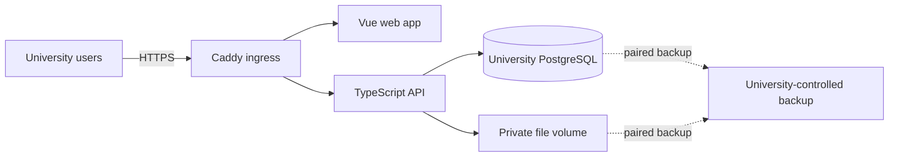

# Rafik architecture

**Status: current architecture, 17 October 2026.** The university-owned Compose deployment and Stage 5 prototype workflows are implemented locally. Optional Stage 6 provider-specific VM templates exist as unverified starters; provider validation is deferred and does not block Stage 7. Stage 7 coach-first Android implementation is active. The [requirements and stage gates](../requirements/README.md) define delivery status; this page describes the system as it exists and the constraints new work must preserve.

## Repository components

Android beta distribution uses a directly signed APK with bundled JavaScript, package ID `org.rafik.field` and a persistent private signing key. Release manifest/network rules allow HTTPS plus only the existing local-development HTTP addresses. The configured native minimum is API 24. Signing files stay outside Git and runtime/server images; artifact installation/upgrade evidence is separate from source/API evidence. See [ADR 0024](../decisions/ADR-0024-android-beta-distribution.md).

Android recovery uses separate fresh authorized reads; comparisons never call `saveRoster` or change pending operation IDs/revisions. Participant history is online-only and not stored in the offline roster. The API returns bounded 25-row attendance audit or score-version pages after event and participant authorization. Revoked reads clear the fetched comparison/history and block original-owner capture while retaining encrypted local work.

Recovery sharing re-reads durable records for the exact account/server/workspace/event. It includes only unresolved commands, score drafts, involved athlete names and event metadata; credentials and unrelated roster members are omitted. The OS chooser receives plain text only after an explicit privacy confirmation. Sharing never changes queue state or implies delivery; exported copies leave app encryption/retention. Oversized text is refused without truncation and individual-item sharing is available. No automatic import or forced conflict merge exists. Locale preference is device-local SecureStore metadata, independent of account tokens and draft ownership.

Staff **Events & assessments** is a separate, server-paginated index of scheduled training and assessments across dates. It keeps existing calendar authority: administrators see institution events; coaches see events where they are designated staff. Summaries include athlete counts, not participant records. Existing event details provide attendance, results and correction history. Athlete workout logs remain in Session history. Profile timezone reads use `asActor` and the profile RLS boundary; workspace data continues through explicit membership checks.

Staff browse-first pages separate assigned programs, recorded workouts and published nutrition guidance. Athlete plans and nutrition summaries use server-paginated workspace reads (24 rows with full matching totals); coaches are restricted to their assigned athletes. Workout history uses the existing bounded delivery cursor. Assignment previews resolve immutable program versions. Nutrition overview returns identity, revision, dates and derived status only; opening a version uses the existing subject authorization and diary-sharing boundary. These web-only routes are outside the supported coach field OpenAPI subset.

Event-template creation can open a separate tab. A same-origin BroadcastChannel scoped to account/institution sends the event-draft ID and new template ID; the composer re-fetches the template through its authorized API before selecting it. Refresh remains available when cross-tab messaging is unavailable.

The backend serves its coach OpenAPI contract and bundled Swagger UI at `/v1/openapi.json` and `/v1/docs` (`/api/v1/…` through the Compose web proxy). Documentation is public; protected requests retain native bearer authorization. The viewer permits local development requests, disables them in production, omits cookies, does not persist tokens and restricts requests/assets to its own origin. See the [API guide](../reference/api.md).

| Component                     | Responsibility                                                                                                                                                                            |
| ----------------------------- | ----------------------------------------------------------------------------------------------------------------------------------------------------------------------------------------- |
| `apps/frontend/`              | Vue 3 and TypeScript web application. Presents public and organization-scoped administrator, trainer and athlete tasks; stores recoverable drafts and queued commands in browser storage. |
| `apps/backend/`               | TypeScript HTTP API, Prisma schema/client, PostgreSQL migrations, domain authorization, content sources, and private-file lifecycle.                                                      |
| `apps/mobile/`                | Expo/React Native Android coach field app. Stage 7 implementation is in progress; its supported API subset is exported as OpenAPI.                                                        |
| `packages/shared/`            | Shared API contracts and generated database transport types.                                                                                                                              |
| `infrastructure/compose.yaml` | One Compose definition with local-development and self-host profiles. Production profile runs PostgreSQL, migration job, API, web and Caddy.                                              |

The browser calls the API; it never connects directly to PostgreSQL or receives database credentials. PostgreSQL is the durable server store. IndexedDB is for recoverable client work, not backup or acknowledged server state.

The Stage 7 Android workspace has native bearer login/refresh/logout, a bounded coach schedule and field capture for explicitly opened events. The backend serves a versioned OpenAPI subset at `/v1/openapi.json`; see the [API reference](../reference/api.md). Event snapshots, assessment definitions/results, raw score drafts and exact queued commands are partitioned by instance URL, account and workspace in SQLCipher SQLite; native initialization refuses a build without SQLCipher. The key and instance-bound session are kept in SecureStore, and Android app-data backup is disabled. Attendance, assessment entry, event completion and online correction history are implemented. Focused API/emulator evidence and remaining device/release limits are recorded in [verification](../verification/README.md). See [ADR 0023](../decisions/ADR-0023-android-coach-field-app.md) and the [Android guide](../development/android.md).

The attendance queue commits device persistence before reporting it, then sends each immutable operation in order while the app is active. Acknowledgment atomically advances the participant or result revision and marks the command confirmed. A result can be queued after the same athlete’s present command; completion requires all event commands acknowledged and no unresolved drafts. Network/acknowledgment failures retain the exact retry; a process restart treats an interrupted send as uncertain. Authorization/revision rejection pauses later commands for review. A pending roster cannot be overwritten by a newer read. Sign-out removes credentials and attempts device-session revocation while retaining encrypted pending work for its original owner. A confirmed finish evicts the event/roster/results/drafts and local receipts in the same transaction. Completed/cancelled rosters are also evicted on an authorized refresh only after every command is acknowledged; unresolved records require explicit resolution or discard.

## Identity, institution and authorization

Each university runs a separate instance and owns its users, data, secrets, files, backups, retention and infrastructure. There is no default Rafik-hosted tenant or operator access. The supported web experience is organization-scoped. Legacy independent-coaching data and APIs remain isolated during transition, but standalone coach screens are retired; see [ADR 0021](../decisions/ADR-0021-organization-only-web-experience.md). Organization-owned training history belongs to the organization and survives a trainer reassignment.

Every institutional membership has one role: administrator, trainer or athlete. Sign-in opens that role's dashboard; there is no role selector. Administrators manage people, permissions, analytics and programs; trainers receive coaching tools; athletes receive their own training and support navigation. Sidebar groups collapse so the primary navigation stays compact. The platform-administrator grant is separate and appears only for explicitly authorized operators.

Every protected request is authorized against the current actor, selected organization context, resource and lifecycle state. The API derives available actions from its own capabilities; hiding a navigation link is not authorization. Assignment changes or revocations must take effect on subsequent reads, commands and retries. A forward migration reduces legacy multi-role memberships and invitations to one role, prioritizing administrator, then trainer, then athlete; it clears a trainer assignment if that membership no longer retains the athlete role. The [role and scope audit](../requirements/role-scope-audit.md), [ADR 0005](../decisions/ADR-0005-organization-and-independent-scopes.md) and [ADR 0019](../decisions/ADR-0019-single-role-dashboards.md) record this model.

## Commands and durable client work

Domain writes use explicit API commands. The server validates current authority and input, then records related state and its command receipt transactionally. Revision checks, stable operation identifiers and server-owned authorization prevent stale edits or replay from silently creating another result. Client persistence, request dispatch and server acknowledgment are distinct states; the UI must not report a cloud save before acknowledgment. See the [API conventions](../reference/api.md) and [Prisma API ADR](../decisions/ADR-0006-prisma-api-transition.md).

## Organization data boundaries

- Programs, assignments and published training history are organization-scoped. Publishing creates an immutable version and makes the program available in the institution library without a separate visibility hold; assignment is still explicit. A trainer’s access follows current assignment; reassignment does not transfer unrelated personal data.
- Training groups are reusable scheduling rosters. Administrators can include active coaches and athletes; trainers can manage their own groups of assigned athletes. Selecting a group preselects coaches as event staff and athletes as participants, while each event keeps its own fixed roster.
- Messages are participant-scoped. Direct conversations have one institution-wide record per participant pair; each training group has one linked conversation. The conversation list search also matches the other participant’s name in direct conversations, and reports existing pair members so they no longer appear as new People choices. Existing duplicate direct conversations are archived by the forward migration so their message history remains retained.
- The web message composer previews the selected uploaded attachment before sending. Draft writes are serialized; an acknowledged send removes the device draft and resets the uploader, while uncertain or failed sends retain recovery state. Removing a pending attachment changes only the draft, not the server's file-retention rules.
- Messages support up to 10 ordered uploaded files through `organization_message_assets`. A forward migration backfills existing single-file links; legacy `asset_id` remains the first attachment for compatibility. API writes validate every attachment against sender/institution/channel before receipt replay, then commit message, ordered links and receipt together. Private reads and account exports resolve all linked files. Device drafts preserve the ordered list, with compatibility for older single-file drafts.
- Publishing a program exposes its immutable version in the institution library. Other coaches can review it and assign it only to athletes currently assigned to them; drafts remain private to their author and administrators.
- Assessments are assessor-led performance records with defined units and correction history. They are not clinical findings.
- Nutrition plans and athlete-recorded actuals have separate ownership and sharing choices. Withdrawal or reassignment is checked before later reads or command replay.
- Injury participation status is an explicitly limited, consent-gated vertical slice. Coaches see only the assigned athlete’s current status and effective date. Athletes can review, correct, close, withdraw and export their records. The product deletes closed content after 12 months. University privacy/security approval is still required before real athlete data is used. See [ADR 0017](../decisions/ADR-0017-injury-status-minimum.md) and the [Stage 4 workflow audit](../requirements/stage4-workflow-audit.md).
- Exercise names, instructions, still images and videos have separate sources and rights. The software license does not grant rights to bundled media. Manifests pin their source, attribution, license and content hashes; unreviewed assets must not be imported.

## Self-hosted operation

The self-host Compose profile keeps PostgreSQL on an internal container network. Caddy provides HTTPS ingress; the API serves authenticated operations and private-file bytes and stores files on a persistent Docker volume. On an empty instance, the first completed setup creates the super admin and institution in one transaction; setup is then closed. Password sign-in does not depend on mail. Admins create one-time invitations that expire after seven days and share them directly with invitees. Each instance has its own project name, credentials and volumes. No SMTP service, Google service-account key or cloud service credential is required. Keep the instance private until initial setup is complete.

Optional AWS, Google Cloud and Azure starter templates create one VM and provider-specific network/access resources, then prepare the same Compose deployment. PostgreSQL and private files remain on the VM's persistent disk. The templates do not provision managed databases, object storage, DNS, backups or monitoring and are not yet provider-verified. See the [cloud deployment guide](../../infrastructure/cloud/README.md).

Use the [infrastructure guide](../../infrastructure/README.md) for first deployment, [development](../development/README.md) for local setup and [operations](../operations/README.md) for secrets, backups, restore, updates and retention monitoring. Production readiness still depends on the open release and university review gates.

## Instance branding and support boundary

Instance name, accent, custom light/dark page backgrounds and optional logo are stored in PostgreSQL so they survive image upgrades and are included in the normal database backup. Surface colors derive from the page backgrounds, and text/accent colors adjust for contrast. The initial super admin owns these settings; active institution administrators can see the branding panel but cannot change it. The API validates image signatures and permits PNG, JPEG or WebP up to 512 KB. The logo endpoint serves only the configured public brand image with a fixed content type and `nosniff`; no SVG, remote logo URL, arbitrary CSS or script is accepted. Rafik attribution remains visible. Support cases and diagnostics remain local; no telemetry or email delivery is configured.

## Android connection and authority feedback

Connectivity and authorization are separate. A transport failure produces localized connection feedback; HTTP denial remains a server refusal. Following an offline access failure, the signed-in runtime rechecks coach contexts after a successful authenticated response or active retry. Only the context read clears its access warning. Cached work opens after local storage loads rather than waiting for a network timeout. The check does not replace event snapshots or unmount open editors; revoked workspaces have their cached packages blocked. Saved workspace selection remains available for recovery; a removed workspace with no device package yields to the remaining authorized workspace or the no-access screen. Command acknowledgment/revision handling remains independent of this feedback and still requires the exact response to each saved command.

## Data-flow boundary

No default telemetry or outbound data transfer is configured. Optional support flows must be explicit and must not include athlete health data by default. Browser drafts and queued commands are not part of server backup; server database and private files must be backed up and restored together.

## Related decisions

- [ADR 0001: university-owned deployments](../decisions/ADR-0001-university-owned-deployments.md)
- [ADR 0005: organization and legacy independent-data boundaries](../decisions/ADR-0005-organization-and-independent-scopes.md)
- [ADR 0006: Prisma API, identity and file boundary](../decisions/ADR-0006-prisma-api-transition.md)
- [ADR 0017: minimal injury-status boundary](../decisions/ADR-0017-injury-status-minimum.md)
- [ADR 0019: one institutional role per dashboard](../decisions/ADR-0019-single-role-dashboards.md)
- [ADR 0021: organization-only supported web experience](../decisions/ADR-0021-organization-only-web-experience.md)

Previous architecture notes are preserved as dated material in the [documentation archive](../archive/README.md); they are not current implementation guidance.
