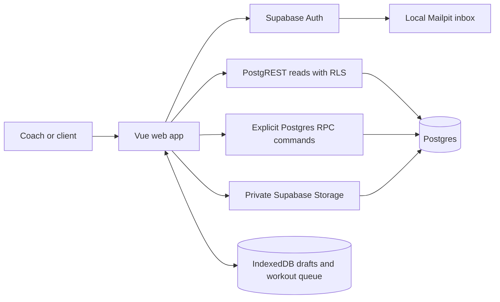

# Working on the Rafik revamp

Last updated: 23 September 2026, R5 product quality and exercise choices. This is the practical entry point for developers and future Codex work. Update it when responsibilities, files or workflows change. The [ledger](ledger.md) records what is actually implemented; [architecture](architecture.md) specifies behavior; [verification](verification.md) records evidence and limits. Use the [engineering index](../README.md) for onboarding. Local R5 implementation and remaining release gates are tracked in [coverage](revamp-coverage.md) and the ledger.

## What changed from the retired product

The old four-repository platform is preserved in Git history and audited in `docs/revival`. The new runtime uses **two repositories, one Vue web application and one local Supabase project**. The old native and worker implementations are parked, not dependencies. There is no legacy compatibility layer or old-user migration requirement.

Backend baseline before revamp: `652e9ee`; frontend baseline: `a0c723e`. Foundation checkpoints: backend `dc60441`, frontend `a6afdc3`. R1 checkpoints: backend `31084bb`, frontend `8097f0d`. Root `CHANGELOG.md` files describe subsequent phases. Do not use old source links in the audit as current implementation instructions.

The new application has one person identity who may train, coach, or do both. A direct coach–client relationship grants access. Plans publish immutable versions; sessions copy the prescription and save actual results through explicit commands. R1 adds client context, private exercise content and richer cycles. R2 adds ongoing coaching through versioned question snapshots, measurements and conversations. R3 adds optional nutrition, concrete appointment booking and private files. R4 adds optional fixed-role teams, client-consented handoff, shared libraries/groups and local commercial/support operations. Old trigger-driven orchestration, organization setup requirements, credits, provider chains and global store complexity have not been restored.

## Runtime and responsibilities



- **Database is the authority:** ownership, value bounds, immutable snapshots, revisions and retry semantics live in SQL. RLS permits reads; ordinary direct table writes are revoked.
- **UI owns interaction:** input state, validation hints, loading/error/empty states, navigation and local draft recovery. It never declares a server mutation successful before acknowledgement.
- **Auth is one adapter:** `src/app/auth.ts`. No separate coach identity system.
- **Device storage is limited in purpose:** workout recording supports durable queued commands and offline continuation. Form/template/message drafts support recovery; form submission and new assignment require the backend. Do not claim all screens are offline-first.
- **No notification provider:** in-app activity is derived from requests/messages. Message persistence succeeds independently of any future delivery adapter. Foreground polling is currently sufficient; no Realtime server is enabled.

## Backend file map (`rafik-api`)

```text
AGENTS.md                         required working rules and documentation-update rule
README.md                         quick setup and navigation into maintained docs
CHANGELOG.md                      concrete changes grouped by implementation phase
content/starter.json              canonical shared exercises and starter prescription
supabase/config.toml              local project identity, services and ports
supabase/migrations/
  202609220001_core.sql            identity, relationships, plans, workouts, core commands
  202609220002_daily_coaching.sql  client notes, custom catalog, cycle scheduling, rich results
  202609220003_ongoing_coaching.sql forms/requests, measurements, messages/cursors, progress
  202609220004_nutrition.sql       immutable guidance, saved foods, meal snapshots
  202609220005_appointments.sql    concrete slots, conflict-safe booking and attendance
  202609220006_resources.sql       private file lifecycle, sharing and message attachments
  202609230007_teams.sql           optional team roles/consent/groups/shared assets and start retry
  202609230008_business_support.sql commercial receipts, local simulation, support and deletion guard
  202609230009_exercise_choices.sql frozen alternatives, recorded choice and actual-identity projections
supabase/fixtures-business.sql      local-only simulator enablement, never hosted
supabase/fixtures-users.sql        synthetic local Auth identities
supabase/fixtures-history.sql      synthetic training history
supabase/fixtures-coaching.sql     synthetic forms, requests and example conversation
supabase/seed.sql                  GENERATED content + local fixture composition
supabase/tests/
  core.sql                        foundation invariants and account lifecycle
  daily_coaching.sql              R1 domain/ownership/retry/snapshot scenarios
  ongoing_coaching.sql            R2 response/measurement/message lifecycle scenarios
  service_delivery.sql            R3 nutrition/booking/resource lifecycle and access scenarios
  team_business.sql               R4 role/consent/handoff/group/provider/support regressions
  exercise_choices.sql            R5 approval/snapshot/retry/analytics/copy regressions
scripts/verify-teams.mjs           temporary Auth/Storage/handoff/provider/cleanup checks
scripts/support-local.mjs          guarded local operator reply from a text file
scripts/verify-services.mjs        real local HTTP booking race, Storage and account cleanup
scripts/local.mjs                 guarded start/stop/reset/types/env/test commands
scripts/content.mjs               generates seed and sibling web sample from canonical content
scripts/verify-fresh.mjs          isolated clean-schema verification; preserves preview records
docs/implementation/              current contracts, status, maintenance and verification
docs/revival/                     completed audit and historical business/design rationale
```

The backend no longer runs an application API server. `npm start` starts this local Supabase stack. The SQL functions are the API. No service-role key belongs in the web application.

## Frontend file map (`RAFIK-FRONTEND`)

```text
src/App.vue                       shared shell, workspace navigation, language/theme controls
src/app/router.ts                 public/private routes and safe return paths
src/app/auth.ts                   Auth identity and profile loading
src/features/public/             landing, local privacy and not-found page
src/features/account/            login, invitation, settings/export/delete, help/local preview
src/features/training/           Today, public sample, workout logger and history
src/features/coaching/           coach home, roster/client workspace, library, plans and review
src/features/ongoing/
  FormEditor.vue                  reusable check-in/assessment questions, template draft recovery
  RequestsPage.vue                assignment schedule, response queue/history, template links
  ResponsePage.vue                client draft/submission/correction, coach review, comparison
  MessagesPage.vue                participant inbox, paged conversation, context, durable send retry
  ProgressPage.vue                acknowledged exercise trends, current schedule, measurements
  CoachingActivity.vue            actual due/review/unread links on both Today pages
  types.ts                       module data contracts (JSON question/answer shape included)
  helpers.ts                     pure response-state and unit-aware trend calculations
src/features/services/MorePage.vue optional-tool navigation for both workspaces
src/features/nutrition/
  NutritionPage.vue               role-aware guidance, food diary and saved foods
  NutrientFields.vue              optional numeric input with unknown/zero distinction
  model.ts                       typed snapshots and portion-scaled totals
src/features/appointments/
  CalendarPage.vue                offer preview, booking/history, durable command retry
  UpcomingAppointments.vue        next-week read summary on Today
  model.ts                       slot/appointment types and timezone formatting
src/features/resources/
  ResourcesPage.vue              upload/share/download/delete and recovery UI
  files.ts                       authenticated download, byte cleanup and account cleanup
src/features/teams/               list/workspace/invitation, scoped types, explicit pending-command helper
src/features/business/BusinessPage.vue account state/event history and local simulator
src/features/support/SupportPage.vue submitted cases, recoverable draft and response lifecycle
src/components/PageState.vue      common loading/error rendering
src/lib/backend.ts                typed table/RPC entry point, paged record reads, old-host guard
src/lib/database.types.ts         GENERATED SQL schema types
src/lib/domain.ts                 training/program/client domain types
src/lib/prescriptions.ts          schema 1/2 compatibility and target/actual presentation
src/lib/dates.ts                  date-only and timezone utilities
src/lib/storage.ts                IndexedDB stores and account-scoped draft helpers
src/lib/training.ts               workout start/adoption, durable edits, sync, correction/conflict
src/lib/i18n.ts                   bilingual vocabulary, locale and contextual error copy
src/content/sample.json           GENERATED public training sample
src/style.css                    tokens, controls and semantic feature layouts
public/                          local assets/brand; no remote font dependency
scripts/visual-check.mjs           route/width/language/theme overflow checks
scripts/r2-visual-check.mjs        populated ongoing-coaching render and accessibility matrix
scripts/verify-team-layout.ts      populated R4 layout/accessibility matrix; isolated synthetic users
tests/team-fixture.ts              local-only fresh identity setup/cleanup for R4 checks
tests/teams.e2e.ts                 consent/handoff/group lost-ack recovery/business/support UI
tests/*.test.ts                   pure unit/data invariants
tests/*.e2e.ts                    real browser workflows against local Supabase
```

Modules use the existing Vue Composition API; there is no new global store layer, chart package, general form-rule engine or repository abstraction. Check-ins and assessments share one small typed question vocabulary because their assignment/submission/review lifecycle is the same. They retain different purposes and separate compatible-result histories. The editor does not support nested rules, branching, uploads or calculated scoring.

## Routes and a useful test tour

Start at `http://127.0.0.1:5173/local-preview`. Choose **Laila Khoury** for the coach or **Amir Hassan** for the client; these buttons sign into real synthetic local accounts. No emailed code is needed. The ordinary login flow sends mail only to `http://127.0.0.1:55324`.

| Task | Coach | Client |
|---|---|---|
| Work queue | `/coach` | `/today` |
| Programming | `/coach/plans`, `/coach/plans/:planId` | assigned workouts from Today |
| Client context/schedule | `/coach/clients/:relationshipId` | Today schedule |
| Exercise catalog | `/coach/exercises` | exercise instructions inside workout |
| Progress | `/coach/clients/:relationshipId/progress` | `/progress` |
| Requests/history | `/coach/checkins` | `/checkins` |
| Template creation/edit | `/coach/forms/new`, `/coach/forms/:formId` | assigned snapshots only |
| Response/review | `/coach/checkins/:requestId` | `/checkins/:requestId` |
| Conversations | `/coach/messages/:relationshipId` | `/messages/:relationshipId` |

**Client workspace URLs use the relationship UUID, not the person's UUID.** The local Laila–Amir relationship is `40000000-0000-4000-8000-000000000001`.

For R2: open the seeded reflection as Amir, save a draft, submit it; switch to Laila and review it from Today; return as Amir and correct an answer. The review clears and the original submitted timestamp stays fixed. Use **Discuss this response** to send a contextual message, then reply from the coach inbox. Create another assessment from the same template revision to compare compatible numeric results. In Progress, record a measurement with **Only me** or share it explicitly with Laila; correct or remove it. The coach only sees shared records.

## Safe local development

For the exact commands see [runbook](runbook.md). Keep both repositories on `codex/revamp`; never push main. Node is 22.16.0. Docker must be running. Local API: 55321; database: 55322; mail: 55324; dev: 5173; production preview: 5174.

1. Install pinned dependencies with `npm ci` in both checkouts, start the backend, generate the ignored frontend environment with `npm run web-env`.
2. **First setup only, or deliberate fixture restart:** `npm run reset`. This erases the new local preview data. Do not use it simply to test a migration.
3. **Existing preview:** verify `supabase/.temp/project-ref` is absent, then `npx supabase migration up --local` and `npm run types`. Preserve entered notes/invitations/history.
4. Start frontend dev. Build and run preview for browser regression tests. All tests must target this local stack, never hosting.
5. Use `npm run test:fresh` to validate a clean install in a temporary database without disturbing the preview.

Schema changes go into the next migration. Existing uncommitted local migration functions may be iterated during development, but the actual preview schema and checked-in migration must match before completion. Once a migration has been shared/applied beyond this local rebuild, use forward migrations. Never apply synthetic Auth seeds to hosting.

## Change recipes

**New UI capability:** locate the task module, describe the user action and states, add only needed routes/components, then add the bounded command and read policy if data changes. Reuse the semantic tokens and bilingual pairs. Do not add signup questions to expose optional features.

**New question type or answer semantics:** update SQL `validate_coaching_fields` and `save_coaching_response`, then `ongoing/types.ts`, editor and response rendering. Test old assigned snapshots. New template revisions apply only to future assignments. Do not mutate assigned `fields` from the frontend.

**Progress metric:** start from acknowledged `set_entries`, include its unit and meaningful denominator, update `training_progress` plus `helpers.ts` and its pure tests. Never convert a missing value into a reported zero or blend strength/time/distance into one score. Current schedule counts describe the current assignment configuration, not historical adherence after arbitrary schedule edits.

**New message feature:** keep send UUID/payload persistence and context ownership checks. Notification delivery is a future adapter; failures there must not roll back or duplicate a message. Attachments use the implemented R3 resource/share contract and authenticated downloads; do not embed arbitrary public upload URLs in message JSON.

**Shared content:** edit `content/starter.json`; run `npm run content` and `content:check`. Generated files are not independent sources. Synthetic R2 examples live in `fixtures-coaching.sql`; keep them out of production data provisioning.

**Schema:** add a migration, run SQL tests and clean-schema verification, regenerate web types, then build/test affected UI. Add a new SQL suite to both `scripts/local.mjs` and `scripts/verify-fresh.mjs` if introducing a new suite file. Do not hand-edit generated TypeScript.

## Required finish checklist for every future change

- Update the relevant root `CHANGELOG.md` with the actual behavior/files changed; maintain accurate implemented/partial/deferred status in `ledger.md`.
- Update `architecture.md` for any data, ownership, API, snapshot, retry or lifecycle contract change.
- Update this guide and the affected README when files, modules, setup or development workflow change; update the runbook for operational changes.
- Record executed verification and its limitations in `verification.md`. Do not copy a previous test count as evidence for new code. Preserve evidence under `docs/implementation/evidence/` without secrets or user messages.
- Run the checks appropriate to the change and inspect affected rendered screens in both languages and phone/desktop layouts. Keep native and hosting deferred until the user changes that scope.
- Commit code and matching documentation together on `codex/revamp`. Never label the whole revamp complete just because one phase passes local tests.

## Working on R3

The coach routes are `/coach/more`, `/coach/nutrition`, `/coach/appointments` and `/coach/resources`; clients use the same paths without `/coach`. The nutrition/calendar components share presentation where the task overlaps, with role-specific commands. Authorization always lives in SQL, not route names. `/coach/nutrition?client=<relationship UUID>` and `/coach/appointments?client=<relationship UUID>` provide client context. There are no duplicate coach/client stores.

To change nutrition fields, update migration validation and `nutrition/model.ts`, then the small `NutrientFields.vue` component. Preserve nullable unknown values, explicit basis/units/source and immutable meal snapshots. Do not infer targets or import a provider response directly into a client's history. Adding a food lookup later should fill an editable draft through an adapter.

To change scheduling, start with `r3-contract.md` and `appointments.sql`. Keep UTC instants separate from local date/time inputs, preview DST effects and preserve the sorted participant locks. The calendar's persisted pending command must remain unchanged until acknowledged or definitively rejected. Test two concurrent clients and dual-role participants through `npm run test:services`.

To add a file type or change limits, update the private bucket configuration, registration validation, frontend `fileTypes`, accepted input/help copy and service tests together. A resource is usable only after finalization. Never add an overwrite API to change bytes under existing message attachments. Upload a new resource instead. Keep deletion in `files.ts` as retire → Storage remove → metadata remove. Account deletion reuses that function. Exported JSON contains metadata; downloads are separate authenticated byte requests.

Run `npm run test:services` from the backend for real Auth/REST/Storage integration; it creates and deletes only temporary synthetic accounts. The disposable database test now bootstraps the local managed Auth/Storage schemas, strips Rafik's Storage policies from that bootstrap and reapplies them through migrations. It does not copy preview records or physical file bytes. `scripts/r3-visual-check.mjs` in the frontend checks eight role/routes × four widths × two languages × two themes and saves local artifacts. Screenshots and local test logs are ignored, while repeatable checks and results are documented.

Current R3 gaps belong in the ledger: no team ownership, real calendar/reminder provider, large/multipart upload, file scanning or hosted deployment. R4 should extend explicit person/relationship ownership deliberately; it must not expose every private client record just because two coaches join a team.

## Working on R4 safely

1. Read `r4-contract.md` before changing roles, handoff or commercial behavior. Team membership never grants all client data. Add an explicit workflow for any broader sharing; do not relax participant reads.
2. Add new staff roles only if a concrete job cannot be expressed by owner/admin/coach. There is no configurable role builder. Teams are optional; keep solo clients/coaches out of setup forms.
3. Group UI lives in `TeamPage.vue`; persistence is `save_team_group`/`archive_team_group`/`set_team_group_client`, assignment is `assign_team_group`. Keep explicit selection and one transaction/receipt. Do not call assignment repeatedly from a browser loop.
4. Shared plan import must preserve its independent exercise copies. A shared snapshot is not a live reference to a colleague's editable draft. Team file grants stay separate from client relationship shares; use the Resources owner audience list to revoke even after departure.
5. Local commercial defaults live in `business_accounts`; the internal simulator flag lives in `runtime_settings`. Never expose service-role credentials or call provider commands directly from the browser. Changes to provider state must leave training/history usable. Test duplicate, stale and unauthorized events with `npm run test:teams`.
6. R4 screens use one persisted pending command with a stable ID/payload. On reload, show retry even if the last command closed a team or removed the current member. Never silently discard an uncertain command. New mutation functions need a documented exact-retry path.
7. After schema changes, run `npm test`, `npm run test:fresh`, `npm run test:services`, `npm run test:teams`, schema lint and `npm run types`. Then run web unit/build/format checks and full browser scenarios; `test:teams:layout` verifies R4 rendering. Fresh/test fixture accounts are temporary and cleaned up; do not turn these helpers into deployment seeds.

### R4 manual tour

Use separate browser profiles for Laila, Nour and Amir. At `/local-preview`, choose Laila → More → Teams → create team → Staff → invite `coach2@rafik.test`. Open the link in Nour's profile and accept. As Laila, Clients → choose Amir → request enrollment; Amir sees a Today link and approves in `/teams`. Laila creates a group, adds Amir, selects Amir explicitly, selects a published version and reviews/confirms assignment. Shared library → share a published plan; Nour copies it and can edit/publish independently. Upload files in Resources, then explicitly share them in the team library.

Laila proposes Nour as Amir's new coach; Amir approves with the consequences displayed. Nour can now open the direct coaching workspace. Laila retains her original participant history; Nour cannot read that private history. Team subscription → Local provider simulation can set past due and restore active. Existing workouts stay available. Client Support → choose team → submit a request; team owner/admin responds in Support. Platform support response is a separate guarded CLI operation documented in the runbook.

Team Activity includes rename and owner closure; Staff includes ownership transfer/departure. Group archive removes only its grouping, not assigned plans. These are real local mutations: use clearly named test teams when exploring and close their enrollments/team when finished. No team fixtures are imposed on the existing Laila/Amir preview.

## Engineering handoff and R5 change recipe

Start at [docs/README](../README.md), then [CONTRIBUTING](../../CONTRIBUTING.md); use ADRs for lasting decisions and the architecture/API reference for current contracts. `scripts/check-docs.mjs` checks maintained local documentation links (`npm run test:docs`); historical audit links are deliberately excluded because they reference baseline commits.

When changing exercise choice, touch all relevant layers: SQL validator/snapshot/save/copy/projections in migration 009; `domain.ts` shape; `prescriptions.ts` actual-identity helper; plan editor; workout logger; review; progress/previous-performance; rollback and browser scenarios. Choices travel inside the existing Entry array and durable operation. Do not add a second synchronization channel or mutate `Session.prescription`.

`tests/product-quality.e2e.ts` creates disposable identities with the existing `team-fixture.ts` helper for long-message and exercise-choice journeys. It tests observable composer geometry/focus/read state and blocked-save recovery, rather than only route existence. Existing suites retain dropped-acknowledgement, permissions, lifecycle and actual Storage checks.

Messages layout rules are scoped in `style.css`; changing shared shell sizing requires desktop/phone/RTL/theme inspection plus the full browser suite. Lists currently use complete authorized reads with bounded rendering; do not describe that as server-side pagination or infinite-scale performance.

`npm run test:quality:layout` in the frontend runs the focused 128-layout English/Arabic/theme/width matrix, including an explicit composer-in-viewport assertion. Inspect its ignored `artifacts/r5-final-*` screenshots; metrics alone do not establish usability.
