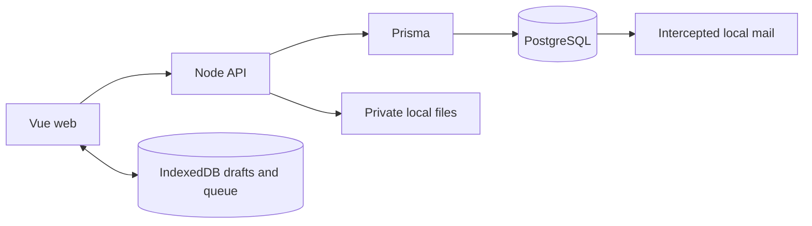

# Working on the Rafik revamp

Updated for R7A1. Read the [ledger](ledger.md), [architecture](architecture.md), [runbook](runbook.md) and [role audit](role-scope-audit.md). Independent teams remain collaboration. R7A2 implements organization membership and views; R8/R9 add owned programs, history and services. Native and hosting remain deferred.

## Runtime responsibilities



The database owns transactional domain invariants, revisions, permissions and immutable snapshots. The API owns authentication, transport validation, bounded reads and file bytes. Vue owns interaction and device recovery, never independent server authority. There is one identity system; organizational role/context expansion follows ADR 0005.

## Backend file map

| Path | Responsibility |
|---|---|
| `compose.yaml` | Isolated local PostgreSQL service, loopback ports and persistent volume |
| `prisma.config.ts` | Migration connection and schema location |
| `prisma/schema.prisma` | ORM models, generated client source declaration |
| `prisma/migrations/` | Forward schema, RLS, constraints and transactional command changes |
| `prisma/fixtures/` | Synthetic local identities, history, coaching and business configuration |
| `prisma/seed.sql` | Generated composition of content and fixtures; empty local database only |
| `server/index.ts` | HTTP routing, origins, payload limits and error boundary |
| `server/db.ts` | Prisma instance and transaction-local actor context |
| `server/auth.ts` | Email challenges, opaque sessions, local preview and logout |
| `server/commands.ts` | Granted command registry, bounded reads and focused projections |
| `server/files.ts` | Private immutable bytes, download and recoverable cleanup |
| `server/generated/` | Ignored generated Prisma client; never edit |
| `tests/sql/` | Seven rollback domain/access/lifecycle suites |
| `tests/api.test.ts` | Actual authentication, pool isolation, transport and file checks |
| `scripts/prisma/local.mjs` | Local start/stop/seed/env/test commands |
| `scripts/prisma/fresh.mjs` | Disposable fresh-schema verification |
| `scripts/prisma/types.ts` | JSON transport types for the web app |
| `scripts/prisma/fixture.mjs` | Guarded local synthetic identity/operator test helpers |
| `scripts/verify-{services,teams}.mjs` | Real HTTP lifecycle/race/access checks |
| `scripts/content.mjs` | Canonical content generation |
| `docs/` | Current engineering references, phase evidence and historical audit |

`npm start` starts/migrates the database; `npm run start:api` runs the API separately. Use the runbook for precise commands. Old runtime source is preserved at backend commit `727f02d`; no legacy services or old data migration are required.

## Frontend file map (`RAFIK-FRONTEND`)

```text
src/App.vue                       shared shell, workspace navigation, language/theme controls
src/app/router.ts                 public/private routes and safe return paths
src/app/auth.ts                   Auth identity and profile loading
src/features/public/             landing, local privacy and not-found page
src/features/account/            login, invitation, settings/export/delete, help/local preview
src/features/training/           Today, public sample, workout logger and history
src/features/coaching/           coach home, roster/client workspace, library, plans and review
src/features/ongoing/
  FormEditor.vue                  reusable check-in/assessment questions, template draft recovery
  RequestsPage.vue                assignment schedule, response queue/history, template links
  ResponsePage.vue                client draft/submission/correction, coach review, comparison
  MessagesPage.vue                participant inbox, paged conversation, context, durable send retry
  ProgressPage.vue                acknowledged exercise trends, current schedule, measurements
  CoachingActivity.vue            actual due/review/unread links on both Today pages
  types.ts                       module data contracts (JSON question/answer shape included)
  helpers.ts                     pure response-state and unit-aware trend calculations
src/features/services/MorePage.vue optional-tool navigation for both workspaces
src/features/nutrition/
  NutritionPage.vue               role-aware guidance, food diary and saved foods
  NutrientFields.vue              optional numeric input with unknown/zero distinction
  model.ts                       typed snapshots and portion-scaled totals
src/features/appointments/
  CalendarPage.vue                offer preview, booking/history, durable command retry
  UpcomingAppointments.vue        next-week read summary on Today
  model.ts                       slot/appointment types and timezone formatting
src/features/resources/
  ResourcesPage.vue              upload/share/download/delete and recovery UI
  files.ts                       authenticated download, byte cleanup and account cleanup
src/features/teams/               list/workspace/invitation, scoped types, explicit pending-command helper
src/features/business/BusinessPage.vue account state/event history and local simulator
src/features/support/SupportPage.vue submitted cases, recoverable draft and response lifecycle
src/components/PageState.vue      common loading/error rendering
src/lib/backend.ts                typed table/RPC entry point, paged record reads, old-host guard
src/lib/database.types.ts         GENERATED SQL schema types
src/lib/domain.ts                 training/program/client domain types
src/lib/prescriptions.ts          schema 1/2 compatibility and target/actual presentation
src/lib/dates.ts                  date-only and timezone utilities
src/lib/storage.ts                IndexedDB stores and account-scoped draft helpers
src/lib/training.ts               workout start/adoption, durable edits, sync, correction/conflict
src/lib/i18n.ts                   bilingual vocabulary, locale and contextual error copy
src/content/sample.json           GENERATED public training sample
src/style.css                    tokens, controls and semantic feature layouts
public/                          local assets/brand; no remote font dependency
scripts/visual-check.mjs           route/width/language/theme overflow checks
scripts/r2-visual-check.mjs        populated ongoing-coaching render and accessibility matrix
scripts/verify-team-layout.ts      populated R4 layout/accessibility matrix; isolated synthetic users
tests/team-fixture.ts              local-only fresh identity setup/cleanup for R4 checks
tests/teams.e2e.ts                 consent/handoff/group lost-ack recovery/business/support UI
tests/*.test.ts                   pure unit/data invariants
tests/*.e2e.ts                    real browser workflows against local PostgreSQL/API
```

Modules use the existing Vue Composition API; there is no new global store layer, chart package, general form-rule engine or repository abstraction. Check-ins and assessments share one small typed question vocabulary because their assignment/submission/review lifecycle is the same. They retain different purposes and separate compatible-result histories. The editor does not support nested rules, branching, uploads or calculated scoring.

## Routes and a useful test tour

Start at `http://127.0.0.1:5173/local-preview`. Choose **Laila Khoury** for the coach or **Amir Hassan** for the client; these buttons sign into real synthetic local accounts. No emailed code is needed. The ordinary login flow sends mail only to `http://127.0.0.1:55324`.

| Task | Coach | Client |
|---|---|---|
| Work queue | `/coach` | `/today` |
| Programming | `/coach/plans`, `/coach/plans/:planId` | assigned workouts from Today |
| Client context/schedule | `/coach/clients/:relationshipId` | Today schedule |
| Exercise catalog | `/coach/exercises` | exercise instructions inside workout |
| Progress | `/coach/clients/:relationshipId/progress` | `/progress` |
| Requests/history | `/coach/checkins` | `/checkins` |
| Template creation/edit | `/coach/forms/new`, `/coach/forms/:formId` | assigned snapshots only |
| Response/review | `/coach/checkins/:requestId` | `/checkins/:requestId` |
| Conversations | `/coach/messages/:relationshipId` | `/messages/:relationshipId` |

**Client workspace URLs use the relationship UUID, not the person's UUID.** The local Laila–Amir relationship is `40000000-0000-4000-8000-000000000001`.

For R2: open the seeded reflection as Amir, save a draft, submit it; switch to Laila and review it from Today; return as Amir and correct an answer. The review clears and the original submitted timestamp stays fixed. Use **Discuss this response** to send a contextual message, then reply from the coach inbox. Create another assessment from the same template revision to compare compatible numeric results. In Progress, record a measurement with **Only me** or share it explicitly with Laila; correct or remove it. The coach only sees shared records.

## Safe local development

For the exact commands see [runbook](runbook.md). Keep both repositories on `codex/revamp`; never push main. Node is 22.16.0. Docker must be running. Local API: 55331; database: 55332; mail: `/local/inbox` on the API; dev: 5173; production preview: 5174.

1. Install pinned dependencies with `npm ci` in both checkouts, start the backend, generate the ignored frontend environment with `npm run web-env`.
2. **Empty first setup only:** `npm run seed:local`. It refuses a populated preview.
3. **Existing preview:** `npm run db:migrate`, `npm run db:generate`, `npm run types`, then restart the API. Preserve entered notes/invitations/history.
4. Start frontend dev. Build and run preview for browser regression tests. All tests must target this local stack, never hosting.
5. Use `npm run test:fresh` to validate a clean install in a temporary database without disturbing the preview.

Schema changes go into the next migration. Existing uncommitted local migration functions may be iterated during development, but the actual preview schema and checked-in migration must match before completion. Once a migration has been shared/applied beyond this local rebuild, use forward migrations. Never apply synthetic Auth seeds to hosting.

## Change recipes

**New UI capability:** locate the task module, describe the user action and states, add only needed routes/components, then add the bounded command and read policy if data changes. Reuse the semantic tokens and bilingual pairs. Do not add signup questions to expose optional features.

**New question type or answer semantics:** update SQL `validate_coaching_fields` and `save_coaching_response`, then `ongoing/types.ts`, editor and response rendering. Test old assigned snapshots. New template revisions apply only to future assignments. Do not mutate assigned `fields` from the frontend.

**Progress metric:** start from acknowledged `set_entries`, include its unit and meaningful denominator, update `training_progress` plus `helpers.ts` and its pure tests. Never convert a missing value into a reported zero or blend strength/time/distance into one score. Current schedule counts describe the current assignment configuration, not historical adherence after arbitrary schedule edits.

**New message feature:** keep send UUID/payload persistence and context ownership checks. Notification delivery is a future adapter; failures there must not roll back or duplicate a message. Attachments use the implemented R3 resource/share contract and authenticated downloads; do not embed arbitrary public upload URLs in message JSON.

**Shared content:** edit `content/starter.json`; run `npm run content` and `content:check`. Generated files are not independent sources. Synthetic R2 examples live in `fixtures-coaching.sql`; keep them out of production data provisioning.

**Schema:** add a migration, run SQL tests and clean-schema verification, regenerate web types, then build/test affected UI. Add a new SQL suite to both `scripts/prisma/local.mjs` and `scripts/prisma/fresh.mjs` if introducing a new suite file. Do not hand-edit generated TypeScript.

## Required finish checklist for every future change

- Update the relevant root `CHANGELOG.md` with the actual behavior/files changed; maintain accurate implemented/partial/deferred status in `ledger.md`.
- Update `architecture.md` for any data, ownership, API, snapshot, retry or lifecycle contract change.
- Update this guide and the affected README when files, modules, setup or development workflow change; update the runbook for operational changes.
- Record executed verification and its limitations in `verification.md`. Do not copy a previous test count as evidence for new code. Preserve evidence under `docs/implementation/evidence/` without secrets or user messages.
- Run the checks appropriate to the change and inspect affected rendered screens in both languages and phone/desktop layouts. Keep native and hosting deferred until the user changes that scope.
- Commit code and matching documentation together on `codex/revamp`. Never label the whole revamp complete just because one phase passes local tests.

## Working on R3

The coach routes are `/coach/more`, `/coach/nutrition`, `/coach/appointments` and `/coach/resources`; clients use the same paths without `/coach`. The nutrition/calendar components share presentation where the task overlaps, with role-specific commands. Authorization always lives in SQL, not route names. `/coach/nutrition?client=<relationship UUID>` and `/coach/appointments?client=<relationship UUID>` provide client context. There are no duplicate coach/client stores.

To change nutrition fields, update migration validation and `nutrition/model.ts`, then the small `NutrientFields.vue` component. Preserve nullable unknown values, explicit basis/units/source and immutable meal snapshots. Do not infer targets or import a provider response directly into a client's history. Adding a food lookup later should fill an editable draft through an adapter.

To change scheduling, start with `r3-contract.md` and `appointments.sql`. Keep UTC instants separate from local date/time inputs, preview DST effects and preserve the sorted participant locks. The calendar's persisted pending command must remain unchanged until acknowledged or definitively rejected. Test two concurrent clients and dual-role participants through `npm run test:services`.

To add a file type or change limits, update the private bucket configuration, registration validation, frontend `fileTypes`, accepted input/help copy and service tests together. A resource is usable only after finalization. Never add an overwrite API to change bytes under existing message attachments. Upload a new resource instead. Keep deletion in `files.ts` as retire → byte removal → metadata remove. Account deletion reuses that function. Exported JSON contains metadata; downloads are separate authenticated byte requests.

Run `npm run test:services` from the backend for real identity/commands/files integration; it creates and deletes only temporary synthetic accounts. The disposable database test applies the same Prisma migrations and synthetic seed to a new database. It does not copy preview records or physical file bytes. `scripts/r3-visual-check.mjs` in the frontend checks eight role/routes × four widths × two languages × two themes and saves local artifacts. Screenshots and local test logs are ignored, while repeatable checks and results are documented.

Current R3 gaps belong in the ledger: no team ownership, real calendar/reminder provider, large/multipart upload, file scanning or hosted deployment. R4 should extend explicit person/relationship ownership deliberately; it must not expose every private client record just because two coaches join a team.

## Working on R4 safely

1. Read `r4-contract.md` before changing roles, handoff or commercial behavior. Team membership never grants all client data. Add an explicit workflow for any broader sharing; do not relax participant reads.
2. Add new staff roles only if a concrete job cannot be expressed by owner/admin/coach. There is no configurable role builder. Teams are optional; keep solo clients/coaches out of setup forms.
3. Group UI lives in `TeamPage.vue`; persistence is `save_team_group`/`archive_team_group`/`set_team_group_client`, assignment is `assign_team_group`. Keep explicit selection and one transaction/receipt. Do not call assignment repeatedly from a browser loop.
4. Shared plan import must preserve its independent exercise copies. A shared snapshot is not a live reference to a colleague's editable draft. Team file grants stay separate from client relationship shares; use the Resources owner audience list to revoke even after departure.
5. Local commercial defaults live in `business_accounts`; the internal simulator flag lives in `runtime_settings`. Never expose service-role credentials or call provider commands directly from the browser. Changes to provider state must leave training/history usable. Test duplicate, stale and unauthorized events with `npm run test:teams`.
6. R4 screens use one persisted pending command with a stable ID/payload. On reload, show retry even if the last command closed a team or removed the current member. Never silently discard an uncertain command. New mutation functions need a documented exact-retry path.
7. After schema changes, run `npm test`, `npm run test:fresh`, `npm run test:services`, `npm run test:teams`, API type checking and `npm run types`. Then run web unit/build/format checks and full browser scenarios; `test:teams:layout` verifies R4 rendering. Fresh/test fixture accounts are temporary and cleaned up; do not turn these helpers into deployment seeds.

### R4 manual tour

Use separate browser profiles for Laila, Nour and Amir. At `/local-preview`, choose Laila → More → Teams → create team → Staff → invite `coach2@rafik.test`. Open the link in Nour's profile and accept. As Laila, Clients → choose Amir → request enrollment; Amir sees a Today link and approves in `/teams`. Laila creates a group, adds Amir, selects Amir explicitly, selects a published version and reviews/confirms assignment. Shared library → share a published plan; Nour copies it and can edit/publish independently. Upload files in Resources, then explicitly share them in the team library.

Laila proposes Nour as Amir's new coach; Amir approves with the consequences displayed. Nour can now open the direct coaching workspace. Laila retains her original participant history; Nour cannot read that private history. Team subscription → Local provider simulation can set past due and restore active. Existing workouts stay available. Client Support → choose team → submit a request; team owner/admin responds in Support. Platform support response is a separate guarded CLI operation documented in the runbook.

Team Activity includes rename and owner closure; Staff includes ownership transfer/departure. Group archive removes only its grouping, not assigned plans. These are real local mutations: use clearly named test teams when exploring and close their enrollments/team when finished. No team fixtures are imposed on the existing Laila/Amir preview.

## Engineering handoff and R5 change recipe

Start at [docs/README](../README.md), then [CONTRIBUTING](../../CONTRIBUTING.md); use ADRs for lasting decisions and the architecture/API reference for current contracts. `scripts/check-docs.mjs` checks maintained local documentation links (`npm run test:docs`); historical audit links are deliberately excluded because they reference baseline commits.

When changing exercise choice, touch all relevant layers: SQL validator/snapshot/save/copy/projections in migration 009; `domain.ts` shape; `prescriptions.ts` actual-identity helper; plan editor; workout logger; review; progress/previous-performance; rollback and browser scenarios. Choices travel inside the existing Entry array and durable operation. Do not add a second synchronization channel or mutate `Session.prescription`.

`tests/product-quality.e2e.ts` creates disposable identities with the existing `team-fixture.ts` helper for long-message and exercise-choice journeys. It tests observable composer geometry/focus/read state and blocked-save recovery, rather than only route existence. Existing suites retain dropped-acknowledgement, permissions, lifecycle and actual Storage checks.

Messages layout rules are scoped in `style.css`; changing shared shell sizing requires desktop/phone/RTL/theme inspection plus the full browser suite. Lists currently use complete authorized reads with bounded rendering; do not describe that as server-side pagination or infinite-scale performance.

`npm run test:quality:layout` in the frontend runs the focused 128-layout English/Arabic/theme/width matrix, including an explicit composer-in-viewport assertion. Inspect its ignored `artifacts/r5-final-*` screenshots; metrics alone do not establish usability.

## R6 maintenance and release recipe

- Responsive geometry: `tests/layout-contract.ts` detects document overflow and internal clipping; `tests/responsive-inbox.e2e.ts` uses fresh long-name multi-contact fixtures, short/tall/landscape/resized viewports and both engines. `scripts/audit-product.ts` is the broad client/coach route audit (`npm run test:product:layout`). The team layout script also uses the shared checker and runs in both Chromium and WebKit; reports are `artifacts/r4-layout.json` and `artifacts/r6-team-webkit.json`. Capture the actual loaded data surface and inspect screenshots; single page-height or selected-detail coverage is insufficient.
- Inbox CSS: remove obsolete flex-basis/direction rules; the phone grid and inbox must have zero minimum width, contact rows intrinsic height, and vertical scrolling bounded by the workspace. Native select text must stay inside the input in Safari/RTL. Roster renders twelve clients at a time; search/status operates over all loaded authorized rows and resets the visible count.
- Offline updates: `build/offline-shell.ts` hashes contents and generates the worker; `src/app/updates.ts` registers/checks it; `src/components/AppUpdates.vue` provides shared Help/Settings UI. `npm run test:build` checks final emitted files and two HTML-only builds; worker generation must run after all bundler transforms. `tests/app-updates.e2e.ts` serves a real production bundle under two release identities plus a failed installation, preserving actual IndexedDB work across activation and offline reload. Never add `skipWaiting` or automatic reload without a new cross-tab/draft contract.
- Release gate: from backend, `npm run verify:release -- --check` validates prerequisites; `npm run verify:release -- --full` runs the complete local chain serially. See the runbook for reports and recovery. `npm run test:release` checks rejection of remote/wrong-project/main/wrong-runtime prerequisites. New scripts must never print local service credentials.

## Daily workspace maintenance (R7)

`src/features/workspace/WorkspaceNav.vue` owns role-specific primary/secondary links, `types.ts` describes attention rows, and `src/styles/workspace.css` owns the compact shell and daily layouts. `CoachHome.vue` composes the attention projection and upcoming appointments; `TodayPage.vue` uses `client_today`; `ClientsPage.vue` uses cursor-based `coach_roster`. Change these read contracts in migration 010 or a forward migration as appropriate, regenerate types, and run `daily_workspace.sql` plus `tests/workspace.e2e.ts`. Keep More and desktop navigation aligned so phone secondary tools remain discoverable.

## Working on organization contexts

Read [R7A2](r7a2-contract.md). API logic is `server/workspaces.ts`; membership schema/lifecycle is in Prisma migrations 130–150. Never infer a global coach/admin grant from an organization role. Add domain operations behind `scoped`/`mutation`, passing the explicit organization ID and required fixed role, and validate related membership IDs in that same organization. Receipts must not bypass revocation. The database login for ORM organization tables is API-internal; no generic browser table grant is added.

Web views/types/styles live in `src/features/organizations/`. `auth.ts` fetches valid contexts; the shell renders them. Draft and pending keys include account, organization and role. `tests/workspaces.test.ts` exercises HTTP access/lifecycle; web `tests/organizations.e2e.ts` exercises actual invitation/assignment/recovery/revocation. Add new checks to the serial release runner. Current organization membership names are scoped snapshots, separate from a person's independent profile.
