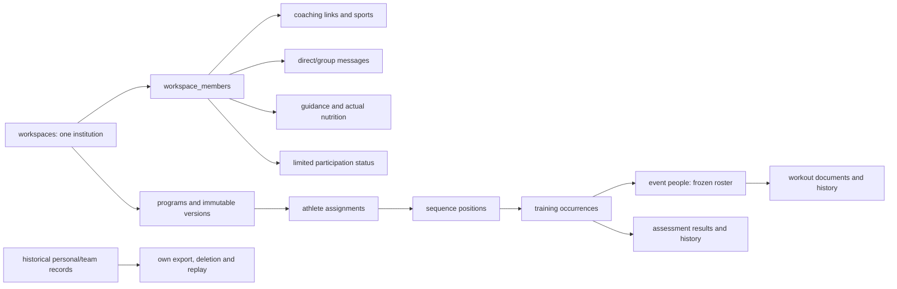

# Backend reference and audit

Reviewed 23 October 2026 for the unreleased beta.3 branch. This is a schema/source audit with focused runtime verification, not production-data, penetration, browser or Android acceptance. The published version remains beta.2.

## Start here

- [Schema and field catalog](schema.md): all 94 physical tables and 761 columns, reviewed purposes, native types/defaults/nullability, incoming relationships, SQL constraints/indexes/policies/triggers and source modules.
- [Routes and data dependencies](routes.md): 65 reviewed route records (some support multiple methods), authority, app/workflow, handlers, conservative transitive table touches, 11 compatibility commands and 33 query projections. This is broader than the field OpenAPI subset.
- [Reusable audit prompt](audit-prompt.md): scope, removal criteria and verification procedure for future contributors.
- [Canonical API contract](../../../apps/backend/openapi.json) and [API guide](../api.md): supported wire shapes and actual implemented behavior.

## Institutional data map



The [schema catalog](schema.md) gives every physical foreign key, including cross-domain links omitted from this overview. `workspace_id` remains a durable institution boundary; it does not imply a chooser or multiple current institutions.

## Findings and changes

| Finding | Action and reason |
| --- | --- |
| Four standalone read routes outlived their web UI. | Removed coach recipients/analytics, standalone conversation reads and upcoming personal appointments, plus exclusive handlers and the independent-practice gate. No maintained web/Android runtime caller remains. Old frontend test references are separately flagged below. |
| HTTP operations were discovered entirely from SQL grants. | Added explicit command/query allowlists. SQL grants/RLS remain required, but a new grant cannot silently publish another legacy workflow. |
| Provider simulation has no institutional purpose or historical record value. | Forward migration removes `runtime_settings` and its two flag fields plus `simulate_business_event`/`apply_business_event`. Historical account/event records remain intact for own export/deletion. |
| Internal feature files still carried unnecessary organization prefixes. | Renamed ten modules to plain domains (calendar, assets, communication, feedback, follow-up, injuries, injury-retention, nutrition, sports and service-catalog), updating imports and maintained links. Wire/schema identifiers remain compatible. |
| Context responses still advertised old role/organization browser paths. | Return `/dashboard` while retaining workspace/member IDs and native owner/context identity. |
| Own institutional export omitted workout corrections and the new sequence metadata. | Include subject-scoped workout history, positions and recurrence rules; an administrator's own export does not expose another athlete's records. |
| Prisma password-token relationships, native-session metadata and two historical partial-index reverse relations lagged SQL. | Align FK relations, index names/partial predicate and generated-ID default with SQL. Historical bookings/assignments use reverse arrays because uniqueness applies only to active rows. No identity/history rows are rewritten. |
| Two HTTP runners exercised retired standalone bookings/commercial teams. | Remove those runners/scripts and CI/full-runner entries. Keep focused institutional suites and historical lifecycle SQL under an explicitly historical name. Retain file-recovery coverage using a guarded disposable fixture rather than restoring an obsolete creation endpoint. |

## Apparent duplicates that cannot be blindly merged

| Old / current records | Why they remain distinct |
| --- | --- |
| Personal plans/versions and institution programs/versions | Different ownership and immutable source identities. Old versions still anchor historical prescriptions and reference fixtures. New personal authoring endpoints are blocked. |
| Personal sessions/set entries and institution workout documents/history | Existing workout IDs, exact receipts and subject privacy survive. Institutional sequence/group work must not reinterpret an old payload as another occurrence. |
| Personal resources/file metadata and institution assets | Historical RLS/private pair sharing differs from current institution/channel authority. Byte storage is already shared through `private-bytes.ts`; combining permission models would be unsafe. |
| Teams and institution membership | Historical team enrollment/handoff data still participates in own export/deletion guards. No new standalone team acquisition endpoint remains. |
| Personal pair messages and institution channels | Historical pair privacy is not equivalent to group visibility. Retaining export data does not retain a standalone conversation screen. |

Current table names with `organization_`, legacy `client_id` payload fields and v1 `/workspaces` paths are compatibility identifiers. Cosmetic renaming is deferred until a scoped migration/API/queue transition is implemented; it is not a reason to drop a live foreign key or saved command.

## Before beta.3 release

| Priority | Evidence/status | Required follow-up |
| --- | --- | --- |
| P1 | Accepted beta.3 scope, not implemented by this audit | Complete recurring/day-only scheduling, group workout sources/per-participant records, web controls and Android offline workout capture with capability/queue migration. See [beta.3 scope](../../requirements/beta3-sessions.md). |
| P1 | Source finding: older frontend dashboard/layout fixtures still reference standalone `/coach` routes and `/v1/coach/analytics`. They were not run here. | Migrate or retire those obsolete journeys and review the full release-runner list before claiming whole CI/browser acceptance. Do not restore retired endpoints to satisfy an old fixture. |
| P1 | Existing draft landing PR reports a merge conflict with newer main. No merge attempted. | Reconcile the documentation branch with the current landing source during release preparation, preserving its separately maintained design work. |
| P1 | Existing default-branch dependency alerts were reported by GitHub; no dependency audit was repeated in this cleanup. | Resolve or assess current advisories in the release dependency pass; do not describe them as fixed here. |
| P2 | Retained SQL lifecycle/source dependencies are documented, not erased. | Replace profile/support/complete own-account export with explicit services before retiring the remaining generic adapters or historical storage. Preserve fields and recovery, not just row counts. |
| P2 | Source finding: institutional own export materializes complete subject arrays; legacy projection pagination has an offset bound. | Design bounded/streamed large-history export before operating at large scale. No large-scale performance claim is made. |
| Deployment gate | Existing founder direction accepts non-code gates into the first-user backlog. | Per-institution live-data/privacy approval, restore rehearsal and broader device/accessibility evidence stay in that backlog; they are not fabricated beta.1 blockers. |

## Keeping this reference current

From the repository root:

```bash
npm run backend:inventory
npm run backend:inventory:check
```

These are source-only and do not start an API/database. They require reviewed metadata for every model/route and a catalog matching the migration digest. After changing migrations, with local Docker running:

```bash
npm run backend:inventory:database
```

That command creates a disposable database, applies all migrations, captures schema metadata and generates matching client/transport types; it drops only that database. It never resets/seeds preview data. The raw [catalog receipt](../../verification/receipts/backend-schema-catalog.json) contains schema definitions and grants, not account/athlete rows.

Generated route touches are conservative, including known helper/SQL calls. Dynamic SQL, triggers and cascade lifecycle can have additional effects. Human review is still required when changing authority, names or retained data. Record actual checks and limits in [verification](../../verification/README.md).
