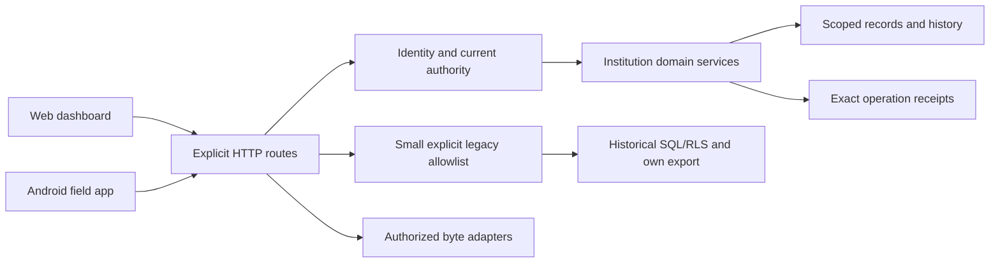

# Backend route reference

Generated from reviewed registrations in `server/index.ts`, authentication/doc dispatchers, handler call graphs and schema metadata. Methods listed are implemented routes, not proposed URLs. The canonical OpenAPI remains the supported field/API contract subset. Dynamic request URLs can be assembled in shared client helpers; the consumer description is reviewed, while literal matches are only source evidence.

## Route and data-flow map

## Registered routes

### GET /health

Database liveness only.

- Authority: Public liveness.
- Apps/workflow: Compose/local operator.
- Handler: Inline liveness query.
- Source-derived table touches (including known called helpers/SQL functions): Static reference/byte content; no direct table dependency found.

### GET /v1/instance/branding

Instance name and theme.

- Authority: Public reference; no account or athlete rows.
- Apps/workflow: Web entry/theme/settings; Android branding.
- Handler: [readBranding](../../../apps/backend/server/instance-branding.ts).
- Source-derived table touches (including known called helpers/SQL functions): [public.instance_branding](schema.md#publicinstance_branding).

### GET /v1/instance/branding/logo

Default/custom installation logo.

- Authority: Public reference; no account or athlete rows.
- Apps/workflow: Web entry/theme/settings; Android branding.
- Handler: [readBrandingLogo](../../../apps/backend/server/instance-branding.ts).
- Source-derived table touches (including known called helpers/SQL functions): [public.instance_branding](schema.md#publicinstance_branding).

### GET /v1/instance/branding/can-manage

Check founder branding authority.

- Authority: Current signed-in institution membership; handler enforces its role/subject scope.
- Apps/workflow: Web entry/theme/settings; Android branding.
- Handler: [canManageBranding](../../../apps/backend/server/instance-branding.ts).
- Source-derived table touches (including known called helpers/SQL functions): [public.instance_branding](schema.md#publicinstance_branding), [public.institution_members](schema.md#publicinstitution_members).

### GET /v1/catalog/foods

Versioned reference content and provenance.

- Authority: Public reference; no account or athlete rows.
- Apps/workflow: Web exercise/nutrition discovery.
- Handler: [foodCatalog](../../../apps/backend/server/public-catalog.ts).
- Source-derived table touches (including known called helpers/SQL functions): Static reference/byte content; no direct table dependency found.

### GET /v1/catalog/exercises

Versioned reference content and provenance.

- Authority: Public reference; no account or athlete rows.
- Apps/workflow: Web exercise/nutrition discovery.
- Handler: [exerciseDatasetCatalog](../../../apps/backend/server/public-catalog.ts).
- Source-derived table touches (including known called helpers/SQL functions): Static reference/byte content; no direct table dependency found.

### GET /v1/catalog/wger-exercises

Versioned reference content and provenance.

- Authority: Public reference; no account or athlete rows.
- Apps/workflow: Web exercise/nutrition discovery.
- Handler: [wgerExerciseCatalog](../../../apps/backend/server/public-catalog.ts).
- Source-derived table touches (including known called helpers/SQL functions): Static reference/byte content; no direct table dependency found.

### GET /v1/catalog/exercise-media

Versioned reference content and provenance.

- Authority: Public reference; no account or athlete rows.
- Apps/workflow: Web exercise/nutrition discovery.
- Handler: [exerciseMediaCatalog](../../../apps/backend/server/public-catalog.ts).
- Source-derived table touches (including known called helpers/SQL functions): Static reference/byte content; no direct table dependency found.

### GET /v1/catalog/exercise-videos

Versioned reference content and provenance.

- Authority: Public reference; no account or athlete rows.
- Apps/workflow: Web exercise/nutrition discovery.
- Handler: [exerciseVideoCatalog](../../../apps/backend/server/public-catalog.ts).
- Source-derived table touches (including known called helpers/SQL functions): Static reference/byte content; no direct table dependency found.

### GET /v1/catalog/exercise-media/{asset}/{frame}.svg

Pinned reference illustration bytes.

- Authority: Public reference; no account or athlete rows.
- Apps/workflow: Web exercise media.
- Handler: [exerciseMediaAsset](../../../apps/backend/server/public-catalog.ts).
- Source-derived table touches (including known called helpers/SQL functions): Static reference/byte content; no direct table dependency found.

### GET / HEAD /v1/catalog/exercise-videos/{asset}.{mp4|webp}

Pinned video/poster bytes with byte ranges.

- Authority: Public reference; no account or athlete rows.
- Apps/workflow: Web exercise previews.
- Handler: [exerciseVideoAsset](../../../apps/backend/server/public-catalog.ts).
- Source-derived table touches (including known called helpers/SQL functions): Static reference/byte content; no direct table dependency found.

### GET /v1/institution/scheduled-events

Paged timed training/assessment index.

- Authority: Current signed-in institution membership; handler enforces its role/subject scope.
- Apps/workflow: Web Schedule list.
- Handler: [scheduledEvents](../../../apps/backend/server/calendar.ts).
- Source-derived table touches (including known called helpers/SQL functions): [public.institution_events](schema.md#publicinstitution_events), [public.institution_members](schema.md#publicinstitution_members).

### GET /v1/institution/nutrition-plans

Paged athlete nutrition assignments.

- Authority: Current signed-in institution membership; handler enforces its role/subject scope.
- Apps/workflow: Web nutrition directory.
- Handler: [nutritionPlanIndex](../../../apps/backend/server/nutrition-plan-index.ts).
- Source-derived table touches (including known called helpers/SQL functions): [public.institution_coaching_links](schema.md#publicinstitution_coaching_links), [public.institution_members](schema.md#publicinstitution_members), [public.institution_nutrition_plans](schema.md#publicinstitution_nutrition_plans), [public.profiles](schema.md#publicprofiles).

### GET /v1/institution/athlete-plans

Paged active/expired athlete program assignments.

- Authority: Current signed-in institution membership; handler enforces its role/subject scope.
- Apps/workflow: Web athlete plans.
- Handler: [athletePlans](../../../apps/backend/server/athlete-plans.ts).
- Source-derived table touches (including known called helpers/SQL functions): [public.institution_assignments](schema.md#publicinstitution_assignments), [public.institution_coaching_links](schema.md#publicinstitution_coaching_links), [public.institution_members](schema.md#publicinstitution_members), [public.profiles](schema.md#publicprofiles).

### GET /v1/institution/recipients

Bounded authorized athlete selector.

- Authority: Current signed-in institution membership; handler enforces its role/subject scope.
- Apps/workflow: Web delivery/nutrition/groups.
- Handler: [institutionRecipients](../../../apps/backend/server/people.ts).
- Source-derived table touches (including known called helpers/SQL functions): [public.institution_assignments](schema.md#publicinstitution_assignments), [public.institution_members](schema.md#publicinstitution_members).

### GET /v1/institution/people

Role-aware institution directory.

- Authority: Current signed-in institution membership; handler enforces its role/subject scope.
- Apps/workflow: Web People.
- Handler: [institutionPeople](../../../apps/backend/server/people.ts).
- Source-derived table touches (including known called helpers/SQL functions): [public.institution_members](schema.md#publicinstitution_members).

### GET /v1/institution/people/{member}

Authorized athlete/coach profile and administrator staff analytics.

- Authority: Current signed-in institution membership; handler enforces its role/subject scope.
- Apps/workflow: Web profile pages.
- Handler: [institutionMemberProfile](../../../apps/backend/server/people.ts).
- Source-derived table touches (including known called helpers/SQL functions): [public.institution_coaching_links](schema.md#publicinstitution_coaching_links), [public.institution_event_people](schema.md#publicinstitution_event_people), [public.institution_members](schema.md#publicinstitution_members), [public.institution_sessions](schema.md#publicinstitution_sessions).

### POST /v1/institution/branding

Update instance theme/logo.

- Authority: Founder super admin only.
- Apps/workflow: Web institution settings.
- Handler: [updateBranding](../../../apps/backend/server/instance-branding.ts).
- Source-derived table touches (including known called helpers/SQL functions): [public.instance_branding](schema.md#publicinstance_branding), [public.institution_members](schema.md#publicinstitution_members).

### GET / POST /v1/platform

Local operator account/suspension/support control.

- Authority: Separate explicit platform grant.
- Apps/workflow: Web platform operations.
- Handler: [platformRead](../../../apps/backend/server/platform.ts), [platformCommand](../../../apps/backend/server/platform.ts).
- Source-derived table touches (including known called helpers/SQL functions): [identity.sessions](schema.md#identitysessions), [identity.users](schema.md#identityusers), [public.institution_members](schema.md#publicinstitution_members), [public.institutions](schema.md#publicinstitutions), [public.platform_grants](schema.md#publicplatform_grants), [public.platform_identity_state](schema.md#publicplatform_identity_state), [public.platform_operations](schema.md#publicplatform_operations), [public.support_cases](schema.md#publicsupport_cases).

### GET / POST /v1/notifications/preferences

Own notification channel/quiet-time preferences.

- Authority: Own account.
- Apps/workflow: Web notification settings.
- Handler: [notificationPreferences](../../../apps/backend/server/notifications.ts).
- Source-derived table touches (including known called helpers/SQL functions): [public.notification_preferences](schema.md#publicnotification_preferences), [public.profiles](schema.md#publicprofiles).

### GET / POST /v1/notifications

Own bounded notification inbox and read checkpoints.

- Authority: Own account.
- Apps/workflow: Web inbox/bell.
- Handler: [notificationInbox](../../../apps/backend/server/notifications.ts), [readNotification](../../../apps/backend/server/notifications.ts).
- Source-derived table touches (including known called helpers/SQL functions): [public.assessment_results](schema.md#publicassessment_results), [public.institution_events](schema.md#publicinstitution_events), [public.institution_members](schema.md#publicinstitution_members), [public.institution_messages](schema.md#publicinstitution_messages), [public.institution_sessions](schema.md#publicinstitution_sessions), [public.notification_events](schema.md#publicnotification_events), [public.notification_preferences](schema.md#publicnotification_preferences).

### GET / POST /v1/institution/communication

Institution direct/group conversations, reads and messages.

- Authority: Current signed-in institution membership; handler enforces its role/subject scope.
- Apps/workflow: Web messaging/groups.
- Handler: [communication](../../../apps/backend/server/communication.ts), [communicationCommand](../../../apps/backend/server/communication.ts).
- Source-derived table touches (including known called helpers/SQL functions): [public.institution_assets](schema.md#publicinstitution_assets), [public.institution_audit_events](schema.md#publicinstitution_audit_events), [public.institution_channel_members](schema.md#publicinstitution_channel_members), [public.institution_channel_reads](schema.md#publicinstitution_channel_reads), [public.institution_channels](schema.md#publicinstitution_channels), [public.institution_coaching_links](schema.md#publicinstitution_coaching_links), [public.institution_groups](schema.md#publicinstitution_groups), [public.institution_members](schema.md#publicinstitution_members), [public.institution_message_assets](schema.md#publicinstitution_message_assets), [public.institution_messages](schema.md#publicinstitution_messages), [public.institution_operations](schema.md#publicinstitution_operations).

### GET / POST /v1/institution/assets

Institution resource and attachment metadata lifecycle.

- Authority: Current signed-in institution membership; handler enforces its role/subject scope.
- Apps/workflow: Web resources/messages/exercises.
- Handler: [institutionAssets](../../../apps/backend/server/assets.ts), [assetCommand](../../../apps/backend/server/assets.ts).
- Source-derived table touches (including known called helpers/SQL functions): [public.institution_assets](schema.md#publicinstitution_assets), [public.institution_exercises](schema.md#publicinstitution_exercises), [public.institution_members](schema.md#publicinstitution_members), [public.institution_operations](schema.md#publicinstitution_operations).

### GET / POST /v1/institution/injuries

Athlete-authored participation status and consent/history.

- Authority: Current signed-in institution membership; handler enforces its role/subject scope.
- Apps/workflow: Web athlete status; limited coach view.
- Handler: [injuries](../../../apps/backend/server/injuries.ts), [injuryCommand](../../../apps/backend/server/injuries.ts).
- Source-derived table touches (including known called helpers/SQL functions): [public.institution_audit_events](schema.md#publicinstitution_audit_events), [public.institution_injury_access_log](schema.md#publicinstitution_injury_access_log), [public.institution_injury_history](schema.md#publicinstitution_injury_history), [public.institution_injury_operations](schema.md#publicinstitution_injury_operations), [public.institution_injury_permissions](schema.md#publicinstitution_injury_permissions), [public.institution_injury_records](schema.md#publicinstitution_injury_records), [public.institution_members](schema.md#publicinstitution_members).

### GET / POST /v1/institution/sports

Sports, specialties and membership coverage.

- Authority: Current signed-in institution membership; handler enforces its role/subject scope.
- Apps/workflow: Web invites/People/institution settings.
- Handler: [institutionSports](../../../apps/backend/server/sports.ts), [institutionSportsCommand](../../../apps/backend/server/sports.ts).
- Source-derived table touches (including known called helpers/SQL functions): [public.institution_audit_events](schema.md#publicinstitution_audit_events), [public.institution_coaching_links](schema.md#publicinstitution_coaching_links), [public.institution_member_sports](schema.md#publicinstitution_member_sports), [public.institution_members](schema.md#publicinstitution_members), [public.institution_operations](schema.md#publicinstitution_operations), [public.institution_sports](schema.md#publicinstitution_sports).

### GET / POST /v1/institution/feedback

Explicit athlete/session and coach workplace feedback.

- Authority: Current signed-in institution membership; handler enforces its role/subject scope.
- Apps/workflow: Web feedback/reports.
- Handler: [feedback](../../../apps/backend/server/feedback.ts), [feedbackCommand](../../../apps/backend/server/feedback.ts).
- Source-derived table touches (including known called helpers/SQL functions): [public.institution_audit_events](schema.md#publicinstitution_audit_events), [public.institution_event_people](schema.md#publicinstitution_event_people), [public.institution_events](schema.md#publicinstitution_events), [public.institution_members](schema.md#publicinstitution_members), [public.institution_operations](schema.md#publicinstitution_operations), [public.institution_session_feedback](schema.md#publicinstitution_session_feedback), [public.institution_sessions](schema.md#publicinstitution_sessions), [public.institution_workplace_feedback](schema.md#publicinstitution_workplace_feedback).

### GET /v1/institution/follow-up

Outstanding review/attendance/result follow-up, not retired Tasks.

- Authority: Current signed-in institution membership; handler enforces its role/subject scope.
- Apps/workflow: Web dashboard.
- Handler: [followUp](../../../apps/backend/server/follow-up.ts).
- Source-derived table touches (including known called helpers/SQL functions): [public.institution_assignments](schema.md#publicinstitution_assignments), [public.institution_event_people](schema.md#publicinstitution_event_people), [public.institution_events](schema.md#publicinstitution_events), [public.institution_members](schema.md#publicinstitution_members), [public.institution_sessions](schema.md#publicinstitution_sessions).

### GET / POST /v1/institution/nutrition

Nutrition guidance, actuals, sharing and corrections.

- Authority: Current signed-in institution membership; handler enforces its role/subject scope.
- Apps/workflow: Web nutrition/athlete diary.
- Handler: [nutrition](../../../apps/backend/server/nutrition.ts), [nutritionCommand](../../../apps/backend/server/nutrition.ts).
- Source-derived table touches (including known called helpers/SQL functions): [public.institution_audit_events](schema.md#publicinstitution_audit_events), [public.institution_coaching_links](schema.md#publicinstitution_coaching_links), [public.institution_meal_history](schema.md#publicinstitution_meal_history), [public.institution_meals](schema.md#publicinstitution_meals), [public.institution_members](schema.md#publicinstitution_members), [public.institution_nutrition_plans](schema.md#publicinstitution_nutrition_plans), [public.institution_nutrition_sharing](schema.md#publicinstitution_nutrition_sharing), [public.institution_operations](schema.md#publicinstitution_operations), [public.profiles](schema.md#publicprofiles).

### GET / POST /v1/institution

One-institution roster/invitations/settings/role administration.

- Authority: Current signed-in institution membership; handler enforces its role/subject scope.
- Apps/workflow: Web institution/People/admin.
- Handler: [institutionView](../../../apps/backend/server/institution.ts), [institutionCommand](../../../apps/backend/server/institution.ts).
- Source-derived table touches (including known called helpers/SQL functions): [identity.password_setup_tokens](schema.md#identitypassword_setup_tokens), [public.institution_audit_events](schema.md#publicinstitution_audit_events), [public.institution_coaching_links](schema.md#publicinstitution_coaching_links), [public.institution_invitations](schema.md#publicinstitution_invitations), [public.institution_member_sports](schema.md#publicinstitution_member_sports), [public.institution_members](schema.md#publicinstitution_members), [public.institution_operations](schema.md#publicinstitution_operations), [public.institution_sports](schema.md#publicinstitution_sports), [public.institutions](schema.md#publicinstitutions).

### GET / POST /v1/institution/services

Groups and reusable assessment templates.

- Authority: Current signed-in institution membership; handler enforces its role/subject scope.
- Apps/workflow: Web institution workflows; Android calendar attendance/assessment (calendar only).
- Handler: [serviceCatalog](../../../apps/backend/server/service-catalog.ts), [serviceCatalogCommand](../../../apps/backend/server/service-catalog.ts).
- Source-derived table touches (including known called helpers/SQL functions): [public.assessment_templates](schema.md#publicassessment_templates), [public.institution_audit_events](schema.md#publicinstitution_audit_events), [public.institution_coaching_links](schema.md#publicinstitution_coaching_links), [public.institution_group_members](schema.md#publicinstitution_group_members), [public.institution_groups](schema.md#publicinstitution_groups), [public.institution_members](schema.md#publicinstitution_members), [public.institution_operations](schema.md#publicinstitution_operations).

### GET / POST /v1/institution/calendar

Timed roster/attendance/assessment records and correction history.

- Authority: Current signed-in institution membership; handler enforces its role/subject scope.
- Apps/workflow: Web institution workflows; Android calendar attendance/assessment (calendar only).
- Handler: [calendar](../../../apps/backend/server/calendar.ts), [calendarCommand](../../../apps/backend/server/calendar.ts).
- Source-derived table touches (including known called helpers/SQL functions): [public.appointments](schema.md#publicappointments), [public.assessment_result_history](schema.md#publicassessment_result_history), [public.assessment_results](schema.md#publicassessment_results), [public.assessment_templates](schema.md#publicassessment_templates), [public.coach_clients](schema.md#publiccoach_clients), [public.institution_audit_events](schema.md#publicinstitution_audit_events), [public.institution_coaching_links](schema.md#publicinstitution_coaching_links), [public.institution_event_people](schema.md#publicinstitution_event_people), [public.institution_events](schema.md#publicinstitution_events), [public.institution_members](schema.md#publicinstitution_members), [public.institution_operations](schema.md#publicinstitution_operations), [public.institution_workout_positions](schema.md#publicinstitution_workout_positions), [public.profiles](schema.md#publicprofiles).

### POST /v1/institution/calendar-preview

Validate fixed-time series and collisions before creation.

- Authority: Current signed-in institution membership; handler enforces its role/subject scope.
- Apps/workflow: Web institution workflows; Android calendar attendance/assessment (calendar only).
- Handler: [calendarPreview](../../../apps/backend/server/calendar.ts).
- Source-derived table touches (including known called helpers/SQL functions): [public.institution_members](schema.md#publicinstitution_members).

### GET /v1/institution/analytics

Source-labelled institution/coach aggregate reports.

- Authority: Current signed-in institution membership; handler enforces its role/subject scope.
- Apps/workflow: Web institution workflows; Android calendar attendance/assessment (calendar only).
- Handler: [institutionAnalytics](../../../apps/backend/server/analytics.ts).
- Source-derived table touches (including known called helpers/SQL functions): [public.institution_assignments](schema.md#publicinstitution_assignments), [public.institution_coaching_links](schema.md#publicinstitution_coaching_links), [public.institution_event_people](schema.md#publicinstitution_event_people), [public.institution_events](schema.md#publicinstitution_events), [public.institution_members](schema.md#publicinstitution_members), [public.institution_session_feedback](schema.md#publicinstitution_session_feedback), [public.institution_sessions](schema.md#publicinstitution_sessions), [public.institution_versions](schema.md#publicinstitution_versions), [public.institution_workplace_feedback](schema.md#publicinstitution_workplace_feedback), [public.profiles](schema.md#publicprofiles).

### GET /v1/institution/assessment-history

Subject-scoped assessment history and current staffing boundary.

- Authority: Current signed-in institution membership; handler enforces its role/subject scope.
- Apps/workflow: Web institution workflows; Android calendar attendance/assessment (calendar only).
- Handler: [assessmentHistory](../../../apps/backend/server/analytics.ts).
- Source-derived table touches (including known called helpers/SQL functions): [public.assessment_results](schema.md#publicassessment_results), [public.institution_coaching_links](schema.md#publicinstitution_coaching_links), [public.institution_event_people](schema.md#publicinstitution_event_people), [public.institution_events](schema.md#publicinstitution_events), [public.institution_members](schema.md#publicinstitution_members), [public.profiles](schema.md#publicprofiles).

### GET / POST /v1/institution/programs

Institution drafts, immutable publication and library.

- Authority: Current signed-in institution membership; handler enforces its role/subject scope.
- Apps/workflow: Web program/athlete recording; future Android workout capture.
- Handler: [programs](../../../apps/backend/server/programming.ts), [programCommand](../../../apps/backend/server/programming.ts).
- Source-derived table touches (including known called helpers/SQL functions): [public.exercises](schema.md#publicexercises), [public.institution_assets](schema.md#publicinstitution_assets), [public.institution_audit_events](schema.md#publicinstitution_audit_events), [public.institution_exercises](schema.md#publicinstitution_exercises), [public.institution_members](schema.md#publicinstitution_members), [public.institution_operations](schema.md#publicinstitution_operations), [public.institution_programs](schema.md#publicinstitution_programs), [public.institution_versions](schema.md#publicinstitution_versions), [public.program_media](schema.md#publicprogram_media).

### GET / POST /v1/institution/catalog

Institution exercise catalog and edits.

- Authority: Current signed-in institution membership; handler enforces its role/subject scope.
- Apps/workflow: Web program/athlete recording; future Android workout capture.
- Handler: [catalog](../../../apps/backend/server/programming.ts), [programCommand](../../../apps/backend/server/programming.ts).
- Source-derived table touches (including known called helpers/SQL functions): [public.exercises](schema.md#publicexercises), [public.institution_assets](schema.md#publicinstitution_assets), [public.institution_audit_events](schema.md#publicinstitution_audit_events), [public.institution_exercises](schema.md#publicinstitution_exercises), [public.institution_members](schema.md#publicinstitution_members), [public.institution_operations](schema.md#publicinstitution_operations), [public.institution_programs](schema.md#publicinstitution_programs), [public.institution_versions](schema.md#publicinstitution_versions), [public.program_media](schema.md#publicprogram_media).

### GET / POST /v1/institution/delivery

Independent goal-specific plan assignments and end/replacement.

- Authority: Current signed-in institution membership; handler enforces its role/subject scope.
- Apps/workflow: Web program/athlete recording; future Android workout capture.
- Handler: [delivery](../../../apps/backend/server/programming.ts), [deliveryCommand](../../../apps/backend/server/programming.ts).
- Source-derived table touches (including known called helpers/SQL functions): [public.institution_assignments](schema.md#publicinstitution_assignments), [public.institution_audit_events](schema.md#publicinstitution_audit_events), [public.institution_coaching_links](schema.md#publicinstitution_coaching_links), [public.institution_events](schema.md#publicinstitution_events), [public.institution_members](schema.md#publicinstitution_members), [public.institution_operations](schema.md#publicinstitution_operations), [public.institution_programs](schema.md#publicinstitution_programs), [public.institution_sessions](schema.md#publicinstitution_sessions), [public.institution_sports](schema.md#publicinstitution_sports), [public.institution_versions](schema.md#publicinstitution_versions), [public.institution_workout_positions](schema.md#publicinstitution_workout_positions), [public.institution_workout_recurrences](schema.md#publicinstitution_workout_recurrences).

### POST /v1/institution/sessions

Athlete self/delegated actual logging with exact history/retry.

- Authority: Current signed-in institution membership; handler enforces its role/subject scope.
- Apps/workflow: Web program/athlete recording; future Android workout capture.
- Handler: [sessionCommand](../../../apps/backend/server/programming.ts).
- Source-derived table touches (including known called helpers/SQL functions): [public.institution_assignments](schema.md#publicinstitution_assignments), [public.institution_audit_events](schema.md#publicinstitution_audit_events), [public.institution_coaching_links](schema.md#publicinstitution_coaching_links), [public.institution_events](schema.md#publicinstitution_events), [public.institution_injury_records](schema.md#publicinstitution_injury_records), [public.institution_members](schema.md#publicinstitution_members), [public.institution_operations](schema.md#publicinstitution_operations), [public.institution_session_history](schema.md#publicinstitution_session_history), [public.institution_sessions](schema.md#publicinstitution_sessions), [public.institution_workout_positions](schema.md#publicinstitution_workout_positions), [public.profiles](schema.md#publicprofiles).

### POST /v1/institution/workout-scheduling

Fixed-time sequence binding/reschedule/skip; no worker or new UI yet.

- Authority: Current signed-in institution membership; handler enforces its role/subject scope.
- Apps/workflow: Web program/athlete recording; future Android workout capture.
- Handler: [workoutSchedulingCommand](../../../apps/backend/server/programming.ts).
- Source-derived table touches (including known called helpers/SQL functions): [public.appointments](schema.md#publicappointments), [public.coach_clients](schema.md#publiccoach_clients), [public.institution_assignments](schema.md#publicinstitution_assignments), [public.institution_audit_events](schema.md#publicinstitution_audit_events), [public.institution_coaching_links](schema.md#publicinstitution_coaching_links), [public.institution_event_people](schema.md#publicinstitution_event_people), [public.institution_events](schema.md#publicinstitution_events), [public.institution_injury_records](schema.md#publicinstitution_injury_records), [public.institution_members](schema.md#publicinstitution_members), [public.institution_operations](schema.md#publicinstitution_operations), [public.institution_sessions](schema.md#publicinstitution_sessions), [public.institution_workout_positions](schema.md#publicinstitution_workout_positions), [public.profiles](schema.md#publicprofiles).

### GET /v1/workouts/{id}/previous

Own prior exercise actuals.

- Authority: Current signed-in institution membership; handler enforces its role/subject scope.
- Apps/workflow: Web athlete logger and coach review; compatibility path retained.
- Handler: [previousInstitutionPerformance](../../../apps/backend/server/programming.ts).
- Source-derived table touches (including known called helpers/SQL functions): [public.institution_members](schema.md#publicinstitution_members), [public.institution_sessions](schema.md#publicinstitution_sessions).

### GET /v1/workouts/{id}/history

Authorized attributed correction versions.

- Authority: Current signed-in institution membership; handler enforces its role/subject scope.
- Apps/workflow: Web athlete logger and coach review; compatibility path retained.
- Handler: [institutionSessionHistory](../../../apps/backend/server/programming.ts).
- Source-derived table touches (including known called helpers/SQL functions): [public.institution_assignments](schema.md#publicinstitution_assignments), [public.institution_coaching_links](schema.md#publicinstitution_coaching_links), [public.institution_members](schema.md#publicinstitution_members), [public.institution_session_history](schema.md#publicinstitution_session_history), [public.institution_sessions](schema.md#publicinstitution_sessions).

### GET /v1/workouts/{id}

Authorized immutable prescription/actual workout document.

- Authority: Current signed-in institution membership; handler enforces its role/subject scope.
- Apps/workflow: Web athlete logger and coach review; compatibility path retained.
- Handler: [institutionSession](../../../apps/backend/server/programming.ts).
- Source-derived table touches (including known called helpers/SQL functions): [public.institution_assignments](schema.md#publicinstitution_assignments), [public.institution_coaching_links](schema.md#publicinstitution_coaching_links), [public.institution_members](schema.md#publicinstitution_members), [public.institution_sessions](schema.md#publicinstitution_sessions).

### GET / PUT /v1/assets/{id}

Scoped institution private bytes with authorized range reads.

- Authority: Current signed-in institution membership; handler enforces its role/subject scope.
- Apps/workflow: Web files/attachments/resources.
- Handler: [getInstitutionAsset](../../../apps/backend/server/assets.ts), [putInstitutionAsset](../../../apps/backend/server/assets.ts).
- Source-derived table touches (including known called helpers/SQL functions): [public.institution_assets](schema.md#publicinstitution_assets), [public.institution_assignments](schema.md#publicinstitution_assignments), [public.institution_channels](schema.md#publicinstitution_channels), [public.institution_coaching_links](schema.md#publicinstitution_coaching_links), [public.institution_exercises](schema.md#publicinstitution_exercises), [public.institution_members](schema.md#publicinstitution_members), [public.institution_messages](schema.md#publicinstitution_messages), [public.institution_programs](schema.md#publicinstitution_programs), [public.institution_sessions](schema.md#publicinstitution_sessions), [public.institution_versions](schema.md#publicinstitution_versions).

### GET / PUT /v1/program-media/{id}

Private institution program artwork.

- Authority: Current signed-in institution membership; handler enforces its role/subject scope.
- Apps/workflow: Web program create/preview.
- Handler: [getProgramMedia](../../../apps/backend/server/program-media.ts), [putProgramMedia](../../../apps/backend/server/program-media.ts).
- Source-derived table touches (including known called helpers/SQL functions): [public.institution_assignments](schema.md#publicinstitution_assignments), [public.institution_coaching_links](schema.md#publicinstitution_coaching_links), [public.institution_members](schema.md#publicinstitution_members), [public.institution_programs](schema.md#publicinstitution_programs), [public.institution_versions](schema.md#publicinstitution_versions), [public.institutions](schema.md#publicinstitutions), [public.plan_versions](schema.md#publicplan_versions), [public.program_media](schema.md#publicprogram_media).

### GET / PUT / DELETE /v1/files/{owner}/{file}

Historical private byte reads, pending upload recovery and retired-byte cleanup.

- Authority: Owner/retained private RLS; no new resource registration.
- Apps/workflow: Account cleanup and historical recovery only.
- Handler: [fileOperation](../../../apps/backend/server/files.ts).
- Source-derived table touches (including known called helpers/SQL functions): [file_store.objects](schema.md#file_storeobjects), [public.resources](schema.md#publicresources).

### GET /v1/queries/{table}

Explicit allowlisted own historical export/reference projections.

- Authority: Authenticated RLS; public reference exceptions only.
- Apps/workflow: Web account export/support/reference compatibility.
- Handler: [query](../../../apps/backend/server/commands.ts).
- Source-derived table touches (including known called helpers/SQL functions): [public.appointment_slots](schema.md#publicappointment_slots), [public.appointments](schema.md#publicappointments), [public.assignments](schema.md#publicassignments), [public.business_accounts](schema.md#publicbusiness_accounts), [public.business_events](schema.md#publicbusiness_events), [public.client_context](schema.md#publicclient_context), [public.coach_clients](schema.md#publiccoach_clients), [public.coaching_forms](schema.md#publiccoaching_forms), [public.coaching_requests](schema.md#publiccoaching_requests), [public.conversation_reads](schema.md#publicconversation_reads), [public.exercises](schema.md#publicexercises), [public.meal_entries](schema.md#publicmeal_entries), [public.measurements](schema.md#publicmeasurements), [public.messages](schema.md#publicmessages), [public.nutrition_guidance](schema.md#publicnutrition_guidance), [public.plan_versions](schema.md#publicplan_versions), [public.plans](schema.md#publicplans), [public.profiles](schema.md#publicprofiles), [public.resource_shares](schema.md#publicresource_shares), [public.resources](schema.md#publicresources), [public.saved_foods](schema.md#publicsaved_foods), [public.schedule_exceptions](schema.md#publicschedule_exceptions), [public.sessions](schema.md#publicsessions), [public.support_cases](schema.md#publicsupport_cases), [public.team_activity](schema.md#publicteam_activity), [public.team_assignments](schema.md#publicteam_assignments), [public.team_clients](schema.md#publicteam_clients), [public.team_group_members](schema.md#publicteam_group_members), [public.team_groups](schema.md#publicteam_groups), [public.team_members](schema.md#publicteam_members), [public.team_plans](schema.md#publicteam_plans), [public.team_resource_shares](schema.md#publicteam_resource_shares), [public.teams](schema.md#publicteams).

### POST /v1/commands/{name}

Explicit allowlisted profile/support/lifecycle and historical replay commands.

- Authority: Authenticated actor plus SQL grants/RLS; no automatic publication from grants.
- Apps/workflow: Web auth/settings/support/recovery.
- Handler: [command](../../../apps/backend/server/commands.ts).
- Source-derived table touches (including known called helpers/SQL functions): [file_store.objects](schema.md#file_storeobjects), [identity.sessions](schema.md#identitysessions), [identity.users](schema.md#identityusers), [public.appointment_slots](schema.md#publicappointment_slots), [public.appointments](schema.md#publicappointments), [public.coach_clients](schema.md#publiccoach_clients), [public.institution_members](schema.md#publicinstitution_members), [public.institutions](schema.md#publicinstitutions), [public.profiles](schema.md#publicprofiles), [public.resources](schema.md#publicresources), [public.session_operations](schema.md#publicsession_operations), [public.sessions](schema.md#publicsessions), [public.set_entries](schema.md#publicset_entries), [public.support_cases](schema.md#publicsupport_cases), [public.team_clients](schema.md#publicteam_clients), [public.team_members](schema.md#publicteam_members), [public.teams](schema.md#publicteams).

### GET /v1/account/institution

Own institution data export, including former memberships.

- Authority: Own account/subject, not arbitrary institution admin.
- Apps/workflow: Web account export.
- Handler: [institutionAccountData](../../../apps/backend/server/account-data.ts).
- Source-derived table touches (including known called helpers/SQL functions): [public.assessment_result_history](schema.md#publicassessment_result_history), [public.assessment_results](schema.md#publicassessment_results), [public.institution_assets](schema.md#publicinstitution_assets), [public.institution_assignments](schema.md#publicinstitution_assignments), [public.institution_event_people](schema.md#publicinstitution_event_people), [public.institution_meals](schema.md#publicinstitution_meals), [public.institution_members](schema.md#publicinstitution_members), [public.institution_messages](schema.md#publicinstitution_messages), [public.institution_nutrition_plans](schema.md#publicinstitution_nutrition_plans), [public.institution_nutrition_sharing](schema.md#publicinstitution_nutrition_sharing), [public.institution_session_feedback](schema.md#publicinstitution_session_feedback), [public.institution_session_history](schema.md#publicinstitution_session_history), [public.institution_sessions](schema.md#publicinstitution_sessions), [public.institution_workout_positions](schema.md#publicinstitution_workout_positions), [public.institution_workout_recurrences](schema.md#publicinstitution_workout_recurrences), [public.institution_workplace_feedback](schema.md#publicinstitution_workplace_feedback), [public.notification_events](schema.md#publicnotification_events), [public.notification_preferences](schema.md#publicnotification_preferences).

### GET /v1/institution/context

Current membership role identifiers and flat dashboard target.

- Authority: Current signed-in institution membership; handler enforces its role/subject scope.
- Apps/workflow: Web sign-in routing; Android owner/workspace identity.
- Handler: [contexts](../../../apps/backend/server/institution.ts).
- Source-derived table touches (including known called helpers/SQL functions): [public.institution_members](schema.md#publicinstitution_members), [public.platform_grants](schema.md#publicplatform_grants).

### GET / POST /v1/invitations/{token}

Preview or accept current single-use invitation.

- Authority: Valid expiring token; existing signed-in account when accepting.
- Apps/workflow: Web invitation entry.
- Handler: [invitation](../../../apps/backend/server/institution.ts).
- Source-derived table touches (including known called helpers/SQL functions): [public.institution_audit_events](schema.md#publicinstitution_audit_events), [public.institution_invitations](schema.md#publicinstitution_invitations), [public.institution_member_sports](schema.md#publicinstitution_member_sports), [public.institution_members](schema.md#publicinstitution_members), [public.institution_sports](schema.md#publicinstitution_sports), [public.profiles](schema.md#publicprofiles).

### GET / POST /v1/auth/session

Browser identity operation: session.

- Authority: Public setup/sign-in or current own session; local-preview is development-only.
- Apps/workflow: Web first-run/invite/sign-in/settings.
- Handler: [authRoute](../../../apps/backend/server/auth.ts).
- Source-derived table touches (including known called helpers/SQL functions): [identity.mobile_sessions](schema.md#identitymobile_sessions), [identity.password_setup_tokens](schema.md#identitypassword_setup_tokens), [identity.rate_limits](schema.md#identityrate_limits), [identity.sessions](schema.md#identitysessions), [identity.users](schema.md#identityusers), [public.instance_branding](schema.md#publicinstance_branding), [public.institution_audit_events](schema.md#publicinstitution_audit_events), [public.institution_invitations](schema.md#publicinstitution_invitations), [public.institution_member_sports](schema.md#publicinstitution_member_sports), [public.institution_members](schema.md#publicinstitution_members), [public.institution_sports](schema.md#publicinstitution_sports), [public.institutions](schema.md#publicinstitutions), [public.platform_identity_state](schema.md#publicplatform_identity_state), [public.profiles](schema.md#publicprofiles).

### GET / POST /v1/auth/setup-status

Browser identity operation: setup-status.

- Authority: Public setup/sign-in or current own session; local-preview is development-only.
- Apps/workflow: Web first-run/invite/sign-in/settings.
- Handler: [authRoute](../../../apps/backend/server/auth.ts).
- Source-derived table touches (including known called helpers/SQL functions): [identity.mobile_sessions](schema.md#identitymobile_sessions), [identity.password_setup_tokens](schema.md#identitypassword_setup_tokens), [identity.rate_limits](schema.md#identityrate_limits), [identity.sessions](schema.md#identitysessions), [identity.users](schema.md#identityusers), [public.instance_branding](schema.md#publicinstance_branding), [public.institution_audit_events](schema.md#publicinstitution_audit_events), [public.institution_invitations](schema.md#publicinstitution_invitations), [public.institution_member_sports](schema.md#publicinstitution_member_sports), [public.institution_members](schema.md#publicinstitution_members), [public.institution_sports](schema.md#publicinstitution_sports), [public.institutions](schema.md#publicinstitutions), [public.platform_identity_state](schema.md#publicplatform_identity_state), [public.profiles](schema.md#publicprofiles).

### POST /v1/auth/setup

Browser identity operation: setup.

- Authority: Public setup/sign-in or current own session; local-preview is development-only.
- Apps/workflow: Web first-run/invite/sign-in/settings.
- Handler: [authRoute](../../../apps/backend/server/auth.ts).
- Source-derived table touches (including known called helpers/SQL functions): [identity.mobile_sessions](schema.md#identitymobile_sessions), [identity.password_setup_tokens](schema.md#identitypassword_setup_tokens), [identity.rate_limits](schema.md#identityrate_limits), [identity.sessions](schema.md#identitysessions), [identity.users](schema.md#identityusers), [public.instance_branding](schema.md#publicinstance_branding), [public.institution_audit_events](schema.md#publicinstitution_audit_events), [public.institution_invitations](schema.md#publicinstitution_invitations), [public.institution_member_sports](schema.md#publicinstitution_member_sports), [public.institution_members](schema.md#publicinstitution_members), [public.institution_sports](schema.md#publicinstitution_sports), [public.institutions](schema.md#publicinstitutions), [public.platform_identity_state](schema.md#publicplatform_identity_state), [public.profiles](schema.md#publicprofiles).

### POST /v1/auth/logout

Browser identity operation: logout.

- Authority: Public setup/sign-in or current own session; local-preview is development-only.
- Apps/workflow: Web first-run/invite/sign-in/settings.
- Handler: [authRoute](../../../apps/backend/server/auth.ts).
- Source-derived table touches (including known called helpers/SQL functions): [identity.mobile_sessions](schema.md#identitymobile_sessions), [identity.password_setup_tokens](schema.md#identitypassword_setup_tokens), [identity.rate_limits](schema.md#identityrate_limits), [identity.sessions](schema.md#identitysessions), [identity.users](schema.md#identityusers), [public.instance_branding](schema.md#publicinstance_branding), [public.institution_audit_events](schema.md#publicinstitution_audit_events), [public.institution_invitations](schema.md#publicinstitution_invitations), [public.institution_member_sports](schema.md#publicinstitution_member_sports), [public.institution_members](schema.md#publicinstitution_members), [public.institution_sports](schema.md#publicinstitution_sports), [public.institutions](schema.md#publicinstitutions), [public.platform_identity_state](schema.md#publicplatform_identity_state), [public.profiles](schema.md#publicprofiles).

### POST /v1/auth/password-login

Browser identity operation: password-login.

- Authority: Public setup/sign-in or current own session; local-preview is development-only.
- Apps/workflow: Web first-run/invite/sign-in/settings.
- Handler: [authRoute](../../../apps/backend/server/auth.ts).
- Source-derived table touches (including known called helpers/SQL functions): [identity.mobile_sessions](schema.md#identitymobile_sessions), [identity.password_setup_tokens](schema.md#identitypassword_setup_tokens), [identity.rate_limits](schema.md#identityrate_limits), [identity.sessions](schema.md#identitysessions), [identity.users](schema.md#identityusers), [public.instance_branding](schema.md#publicinstance_branding), [public.institution_audit_events](schema.md#publicinstitution_audit_events), [public.institution_invitations](schema.md#publicinstitution_invitations), [public.institution_member_sports](schema.md#publicinstitution_member_sports), [public.institution_members](schema.md#publicinstitution_members), [public.institution_sports](schema.md#publicinstitution_sports), [public.institutions](schema.md#publicinstitutions), [public.platform_identity_state](schema.md#publicplatform_identity_state), [public.profiles](schema.md#publicprofiles).

### POST /v1/auth/accept-invitation

Browser identity operation: accept-invitation.

- Authority: Public setup/sign-in or current own session; local-preview is development-only.
- Apps/workflow: Web first-run/invite/sign-in/settings.
- Handler: [authRoute](../../../apps/backend/server/auth.ts).
- Source-derived table touches (including known called helpers/SQL functions): [identity.mobile_sessions](schema.md#identitymobile_sessions), [identity.password_setup_tokens](schema.md#identitypassword_setup_tokens), [identity.rate_limits](schema.md#identityrate_limits), [identity.sessions](schema.md#identitysessions), [identity.users](schema.md#identityusers), [public.instance_branding](schema.md#publicinstance_branding), [public.institution_audit_events](schema.md#publicinstitution_audit_events), [public.institution_invitations](schema.md#publicinstitution_invitations), [public.institution_member_sports](schema.md#publicinstitution_member_sports), [public.institution_members](schema.md#publicinstitution_members), [public.institution_sports](schema.md#publicinstitution_sports), [public.institutions](schema.md#publicinstitutions), [public.platform_identity_state](schema.md#publicplatform_identity_state), [public.profiles](schema.md#publicprofiles).

### POST /v1/auth/complete-password-setup

Browser identity operation: complete-password-setup.

- Authority: Public setup/sign-in or current own session; local-preview is development-only.
- Apps/workflow: Web first-run/invite/sign-in/settings.
- Handler: [authRoute](../../../apps/backend/server/auth.ts).
- Source-derived table touches (including known called helpers/SQL functions): [identity.mobile_sessions](schema.md#identitymobile_sessions), [identity.password_setup_tokens](schema.md#identitypassword_setup_tokens), [identity.rate_limits](schema.md#identityrate_limits), [identity.sessions](schema.md#identitysessions), [identity.users](schema.md#identityusers), [public.instance_branding](schema.md#publicinstance_branding), [public.institution_audit_events](schema.md#publicinstitution_audit_events), [public.institution_invitations](schema.md#publicinstitution_invitations), [public.institution_member_sports](schema.md#publicinstitution_member_sports), [public.institution_members](schema.md#publicinstitution_members), [public.institution_sports](schema.md#publicinstitution_sports), [public.institutions](schema.md#publicinstitutions), [public.platform_identity_state](schema.md#publicplatform_identity_state), [public.profiles](schema.md#publicprofiles).

### POST /v1/auth/local-preview

Browser identity operation: local-preview.

- Authority: Public setup/sign-in or current own session; local-preview is development-only.
- Apps/workflow: Web first-run/invite/sign-in/settings.
- Handler: [authRoute](../../../apps/backend/server/auth.ts).
- Source-derived table touches (including known called helpers/SQL functions): [identity.mobile_sessions](schema.md#identitymobile_sessions), [identity.password_setup_tokens](schema.md#identitypassword_setup_tokens), [identity.rate_limits](schema.md#identityrate_limits), [identity.sessions](schema.md#identitysessions), [identity.users](schema.md#identityusers), [public.instance_branding](schema.md#publicinstance_branding), [public.institution_audit_events](schema.md#publicinstitution_audit_events), [public.institution_invitations](schema.md#publicinstitution_invitations), [public.institution_member_sports](schema.md#publicinstitution_member_sports), [public.institution_members](schema.md#publicinstitution_members), [public.institution_sports](schema.md#publicinstitution_sports), [public.institutions](schema.md#publicinstitutions), [public.platform_identity_state](schema.md#publicplatform_identity_state), [public.profiles](schema.md#publicprofiles).

### GET /v1/mobile/auth/session

Native identity operation: session.

- Authority: Android marker, opaque bearer/rotating refresh; authentication/rate limits.
- Apps/workflow: Android field sign-in/access check.
- Handler: [mobileAuthRoute](../../../apps/backend/server/auth.ts).
- Source-derived table touches (including known called helpers/SQL functions): [identity.mobile_sessions](schema.md#identitymobile_sessions), [identity.rate_limits](schema.md#identityrate_limits), [identity.sessions](schema.md#identitysessions), [identity.users](schema.md#identityusers), [public.platform_identity_state](schema.md#publicplatform_identity_state).

### POST /v1/mobile/auth/login

Native identity operation: login.

- Authority: Android marker, opaque bearer/rotating refresh; authentication/rate limits.
- Apps/workflow: Android field sign-in/access check.
- Handler: [mobileAuthRoute](../../../apps/backend/server/auth.ts).
- Source-derived table touches (including known called helpers/SQL functions): [identity.mobile_sessions](schema.md#identitymobile_sessions), [identity.rate_limits](schema.md#identityrate_limits), [identity.sessions](schema.md#identitysessions), [identity.users](schema.md#identityusers), [public.platform_identity_state](schema.md#publicplatform_identity_state).

### POST /v1/mobile/auth/refresh

Native identity operation: refresh.

- Authority: Android marker, opaque bearer/rotating refresh; authentication/rate limits.
- Apps/workflow: Android field sign-in/access check.
- Handler: [mobileAuthRoute](../../../apps/backend/server/auth.ts).
- Source-derived table touches (including known called helpers/SQL functions): [identity.mobile_sessions](schema.md#identitymobile_sessions), [identity.rate_limits](schema.md#identityrate_limits), [identity.sessions](schema.md#identitysessions), [identity.users](schema.md#identityusers), [public.platform_identity_state](schema.md#publicplatform_identity_state).

### POST /v1/mobile/auth/logout

Native identity operation: logout.

- Authority: Android marker, opaque bearer/rotating refresh; authentication/rate limits.
- Apps/workflow: Android field sign-in/access check.
- Handler: [mobileAuthRoute](../../../apps/backend/server/auth.ts).
- Source-derived table touches (including known called helpers/SQL functions): [identity.mobile_sessions](schema.md#identitymobile_sessions), [identity.rate_limits](schema.md#identityrate_limits), [identity.sessions](schema.md#identitysessions), [identity.users](schema.md#identityusers), [public.platform_identity_state](schema.md#publicplatform_identity_state).

### GET / HEAD /v1/openapi.json

Bundled canonical contract/viewer assets; production reference-only.

- Authority: Public reference; no account or athlete rows.
- Apps/workflow: Operator/developer API reference.
- Handler: [serveApiDocs](../../../apps/backend/server/api-docs.ts).
- Source-derived table touches (including known called helpers/SQL functions): Static reference/byte content; no direct table dependency found.

### GET / HEAD /v1/docs

Bundled canonical contract/viewer assets; production reference-only.

- Authority: Public reference; no account or athlete rows.
- Apps/workflow: Operator/developer API reference.
- Handler: [serveApiDocs](../../../apps/backend/server/api-docs.ts).
- Source-derived table touches (including known called helpers/SQL functions): Static reference/byte content; no direct table dependency found.

### GET / HEAD /v1/docs/assets/{asset}

Bundled canonical contract/viewer assets; production reference-only.

- Authority: Public reference; no account or athlete rows.
- Apps/workflow: Operator/developer API reference.
- Handler: [serveApiDocs](../../../apps/backend/server/api-docs.ts).
- Source-derived table touches (including known called helpers/SQL functions): Static reference/byte content; no direct table dependency found.

## Explicit compatibility commands

| Command | Purpose / table boundary |
| --- | --- |
| `ensure_profile` | [public.profiles](schema.md#publicprofiles) |
| `update_profile` | [public.profiles](schema.md#publicprofiles) |
| `session_document` | [identity.sessions](schema.md#identitysessions), [public.sessions](schema.md#publicsessions), [public.set_entries](schema.md#publicset_entries) |
| `save_session` | [identity.sessions](schema.md#identitysessions), [public.session_operations](schema.md#publicsession_operations), [public.sessions](schema.md#publicsessions), [public.set_entries](schema.md#publicset_entries) |
| `account_deletion_ready` | [public.institution_members](schema.md#publicinstitution_members), [public.institutions](schema.md#publicinstitutions), [public.team_clients](schema.md#publicteam_clients), [public.teams](schema.md#publicteams) |
| `delete_my_account` | [identity.users](schema.md#identityusers), [public.appointment_slots](schema.md#publicappointment_slots), [public.appointments](schema.md#publicappointments), [public.coach_clients](schema.md#publiccoach_clients), [public.institution_members](schema.md#publicinstitution_members), [public.institutions](schema.md#publicinstitutions), [public.profiles](schema.md#publicprofiles), [public.resources](schema.md#publicresources), [public.team_clients](schema.md#publicteam_clients), [public.team_members](schema.md#publicteam_members), [public.teams](schema.md#publicteams) |
| `retire_resource` | [public.resources](schema.md#publicresources) |
| `remove_resource_record` | [file_store.objects](schema.md#file_storeobjects), [public.resources](schema.md#publicresources) |
| `finish_resource` | [file_store.objects](schema.md#file_storeobjects), [public.resources](schema.md#publicresources) |
| `create_support_case` | [public.support_cases](schema.md#publicsupport_cases), [public.team_clients](schema.md#publicteam_clients), [public.team_members](schema.md#publicteam_members), [public.teams](schema.md#publicteams) |
| `update_support_case` | [public.support_cases](schema.md#publicsupport_cases), [public.team_members](schema.md#publicteam_members), [public.teams](schema.md#publicteams) |

`finish_resource` only finalizes a previously registered owned historical upload; `register_resource` is not exposed. `save_session` saves an existing owned historical workout; it does not restore legacy workout acquisition. Account lifecycle functions retain their subject-scoped SQL dependencies and failure checks.

## Explicit compatibility query projections

- `profiles`: [public.profiles](schema.md#publicprofiles)
- `exercises`: [public.exercises](schema.md#publicexercises)
- `plan_versions`: [public.plan_versions](schema.md#publicplan_versions)
- `sessions`: [public.sessions](schema.md#publicsessions)
- `plans`: [public.plans](schema.md#publicplans)
- `client_context`: [public.client_context](schema.md#publicclient_context)
- `coach_clients`: [public.coach_clients](schema.md#publiccoach_clients)
- `assignments`: [public.assignments](schema.md#publicassignments)
- `schedule_exceptions`: [public.schedule_exceptions](schema.md#publicschedule_exceptions)
- `coaching_forms`: [public.coaching_forms](schema.md#publiccoaching_forms)
- `coaching_requests`: [public.coaching_requests](schema.md#publiccoaching_requests)
- `measurements`: [public.measurements](schema.md#publicmeasurements)
- `messages`: [public.messages](schema.md#publicmessages)
- `conversation_reads`: [public.conversation_reads](schema.md#publicconversation_reads)
- `nutrition_guidance`: [public.nutrition_guidance](schema.md#publicnutrition_guidance)
- `saved_foods`: [public.saved_foods](schema.md#publicsaved_foods)
- `meal_entries`: [public.meal_entries](schema.md#publicmeal_entries)
- `appointment_slots`: [public.appointment_slots](schema.md#publicappointment_slots)
- `appointments`: [public.appointments](schema.md#publicappointments)
- `resources`: [public.resources](schema.md#publicresources)
- `resource_shares`: [public.resource_shares](schema.md#publicresource_shares)
- `teams`: [public.teams](schema.md#publicteams)
- `team_members`: [public.team_members](schema.md#publicteam_members)
- `team_clients`: [public.team_clients](schema.md#publicteam_clients)
- `team_groups`: [public.team_groups](schema.md#publicteam_groups)
- `team_group_members`: [public.team_group_members](schema.md#publicteam_group_members)
- `team_plans`: [public.team_plans](schema.md#publicteam_plans)
- `team_resource_shares`: [public.team_resource_shares](schema.md#publicteam_resource_shares)
- `team_assignments`: [public.team_assignments](schema.md#publicteam_assignments)
- `team_activity`: [public.team_activity](schema.md#publicteam_activity)
- `business_accounts`: [public.business_accounts](schema.md#publicbusiness_accounts)
- `business_events`: [public.business_events](schema.md#publicbusiness_events)
- `support_cases`: [public.support_cases](schema.md#publicsupport_cases)

## Published-client compatibility

Canonical scope is `/v1/institution/...`; its ID is resolved server-side. `/v1/institutions/:id` is internal dispatch only and rejected as a public URL. The dedicated compatibility adapter accepts published APK workspace/context and organization-prefixed record paths without redirects. Supplied IDs retain authorization checks and exact commands retain their payloads. These aliases are additional to the canonical route records, not another institution model. See ADR 0029 for the complete transition boundary.

## Coverage limits

Table touches are conservative source traces, not a query profiler. Dynamic SQL, triggers, cascade deletion and account lifecycle can touch more rows/tables than an individual static path shows; inspect each table's SQL guards above before removal. No route is deemed disposable solely because one literal client URL is absent. Unsupported methods/paths use the existing 404/405 handling; global OPTIONS is protocol handling, not another product route.
