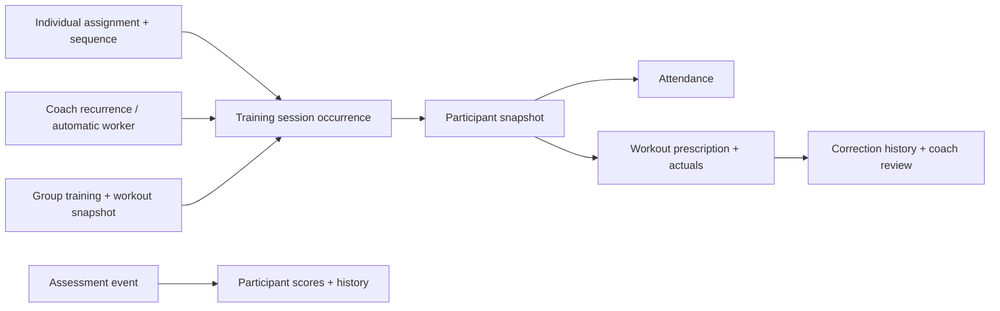

# Beta.3 — sessions, workouts and backend consolidation

Date: 22 October 2026. **Status: accepted product direction; technical proposal awaiting review.** Target release: Squire `1.0.0-beta.3`. Nothing in this document establishes implementation, migration success, Android acceptance or publication. Beta.2 remains the published version.

The earlier [institution cleanup](../decisions/ADR-0026-single-institution-routing-and-task-retirement.md) and [frontend audit](../reference/frontend/README.md) form the first part of this release. The founder has now included session/workout consolidation, its Android impact and a review of legacy backend routes. Keep release work and its paired landing PR unmerged until the release is complete.

## Accepted product rules

| Area                   | Rule                                                                                                                                                                                                     |
| ---------------------- | -------------------------------------------------------------------------------------------------------------------------------------------------------------------------------------------------------- |
| Individual progression | Take workouts in plan sequence. Unresolved prior work blocks the next workout in that assignment only. Explicit completion or skip resolves it; a missed clock time does not silently advance it.        |
| Multiple plans         | Plans progress independently. An unresolved strength workout does not block football training. Same-day work from different plans remains possible.                                                      |
| Explicit scheduling    | Coaches can schedule individual sessions, including weekly recurrence within a selected date range. A scheduled date receives the next eligible workout in that plan sequence.                           |
| Automatic scheduling   | A worker creates eligible work without duplicating unresolved work. It respects rest days and the explicit participation status that prevents training.                                                  |
| Rest days              | Rest days govern worker scheduling; an explicit coach schedule may use a rest day. This does not override a cannot-train restriction.                                                                    |
| Missed sessions        | Keep unresolved work visibly overdue. Coaches can complete, explicitly skip or reschedule it. Subsequent work for that plan stays blocked; do not silently skip or duplicate the workout.                |
| Group training         | Existing training events acquire a shared workout/template with individual attendance, results and completion. Group membership changes do not rewrite historical rosters/results.                       |
| Group progression      | Additional training by default. It does not advance individual assignments. Group plans and automatic group progression are deferred. Using a program workout does not enroll the group in that program. |
| Individual adjustment  | A coach may adapt a participant's prescription without changing everyone else's. Preserve the shared baseline and participant-specific snapshot/history.                                                 |
| Assessments            | Remain a distinct event type with their own definitions, scores and correction history.                                                                                                                  |
| Dashboard              | Show today's actionable individual/group work across the coach's authorized athletes without requiring an athlete selection first.                                                                       |

## Proposed domain model

Keep one training journey, not one table that conflates scheduling, participation and exercise results:

- **Session:** a training occurrence, either individual or group, with source, responsible staff, institution-local date, optional fixed time, timezone and lifecycle. Automatically prepared work need not invent a clock time.
- **Workout:** the exercise prescription and its actual recorded results. Freeze the published source version and any participant adaptation; editing a template cannot rewrite prior records.
- **Participant:** attendance and workout state belong to each athlete, even when the group shares the occurrence. Absence is not a completed workout. Finishing one participant does not finish every participant.
- **Sequence:** advance an individual assignment only through its explicitly linked occurrence. Unlinked group training must never advance it. A coach's supporting scope remains tied to the relevant sport/plan.
- **Future slots:** recurrence can describe future calendar slots, but an unresolved predecessor prevents binding another actionable workout from the same assignment. Show the block and its reason; do not pre-consume the sequence merely by generating dates.

Exact table names and whether existing event/session tables are extended are proposals to settle after migration design. Existing `organization_events` hold scheduled attendance/assessments; `organization_sessions` hold per-assignment exercise documents and history. Their current schemas are separate, and the latter currently requires an assignment. Group additional training therefore needs an explicit source model rather than a fabricated individual assignment.

## Technical review proposal

Reviewed 22 October 2026 against the current event/workout schema, session command handler, native queue/store and SQL gateway. The following is a concrete implementation recommendation, not implemented or yet approved architecture.

### Storage and source identity

Prefer extending existing institutional event and workout records over replacing their IDs/history:

1. A training event becomes the common session occurrence for one or many athlete participants; assessments retain their distinct kind and score model.
2. Add an explicit institution-local training date and timed/day-only mode. Day-only worker sessions have no invented midnight appointment. The existing event table currently requires start/end timestamps, so constraints, calendar queries, analytics and client contracts must all be migrated together before day-only events are written.
3. Reuse participant workout records, preserving existing workout IDs, actuals, feedback and correction history. Add an occurrence/participant link and allow an assignment to be absent only for explicit additional training with an immutable workout source snapshot. Enforce that source distinction in database constraints, not an unchecked nullable assignment.
4. Enforce one current workout record per occurrence/athlete, with audited revisions. Freeze the roster, shared prescription and participant adaptations; current group membership is not the historical roster.
5. Store an assignment progression cursor and an explicit sequence position on its actionable occurrence. Lock the assignment when binding or resolving a position. A calendar slot is not itself a consumed sequence position.
6. Preserve existing IDs while backfilling individual historical occurrences with evidence from their assignment/day/date. Do not attach historical group attendance to an exercise record merely because dates or names match. A dry-run reconciliation must identify ambiguous records before migration.

If the additive event changes cannot preserve current query/receipt behavior cleanly, revisit storage before implementation; do not create a competing second session subsystem simply to avoid that review.

### Progression recommendations for review

- Completing or staff-skipping an occurrence advances its linked assignment position once in the same transaction. Add a resolution ledger/unique position constraint so retries and two devices cannot advance it twice.
- At the end of the published cycle, repeat from the beginning while the assignment remains active and within its configured dates. Preserve cycle/position identity so another cycle is not mistaken for a duplicate of the first. This repeat policy is proposed for approval.
- A later correction edits actual results and appends history without silently rolling back progression or deleting a successor. Reopening progression should require a separately designed explicit action; do not expose it as an incidental result edit. This correction policy is proposed for approval.
- Ending/replacing an assignment cancels unstarted future occurrences, preserves completed history and pauses an in-progress occurrence for explicit staff disposition. Do not automatically declare it completed or erase offline results. This end/replacement policy is proposed for approval.
- An explicit skip requires a staff actor and a reason; absence alone is not a skip. Recurrence cannot manufacture several replacements for the unresolved position. A blocked future slot links back to the original overdue work.

### Canonical API and old-client handling

Propose explicit session/participant/workout operations, with institution and role derived from authenticated membership. Route spelling and DTOs must be reviewed with the OpenAPI change before implementation; a prefix rename alone is not consolidation.

Keep the currently shipped attendance/assessment command shapes and receipt lookup working through a narrow adapter during beta.3. It calls the same domain services as the new session API and does not create a second write implementation. Preserve saved operation IDs, request meaning, actor/resource scope and replay authorization. Document that older APKs retain existing fixed-time attendance/assessment functionality; new day-only sessions and workout capture require the new APK. Agree a later adapter-removal policy after upgrade/pending-work evidence exists; do not use an arbitrary expiry that strands a queued record.

Add server capability discovery for new mobile capture and distinguish an older server from a connection failure. Unsupported server/app combinations must leave saved work reviewable and explain the required upgrade. Capability checks never substitute for command authorization.

The SQL gateway currently discovers callable functions and readable tables from database privileges in `loadContracts()`. RLS still applies; this finding is not proof of a permission bypass. Nevertheless, changing a database grant should not silently publish another legacy workflow as supported HTTP API. Inventory live web calls and pending historical commands, then use an explicit HTTP operation/table allowlist during gateway retirement. Replace profile/account operations with named services where appropriate; retain only the exact legacy replay adapters supported by policy. Do not remove account export, file cleanup or historical receipts by association.

### Native queue evolution

Add an explicit payload/command kind version and cache schema migration. Existing rows keep their original serialized payload, operation ID, owner key, ordering and event ID. New workout commands carry the exact occurrence/participant/workout identity, expected revision, prescription version and actual measurement fields (reps/load/time/distance/effort). Do not regenerate an old operation while upgrading it.

Attendance, workout results and event finish must have explicit dependencies. A locally marked finish cannot bypass unsent participant results. Show device-persisted work separately from acknowledged results, and preserve conflicts/revocations for recovery. Migration acceptance must open a beta.2-format database with queued, sending/uncertain and acknowledged records, upgrade, restart and replay against the upgraded API; tests must inspect the actual native encrypted store as well as the disposable API.

## Proposed lifecycle and transaction rules

| Record               | States / transition rule                                                                                                                                                                                  |
| -------------------- | --------------------------------------------------------------------------------------------------------------------------------------------------------------------------------------------------------- |
| Occurrence           | Planned → in progress → completed; planned work can be cancelled. Overdue and blocked should be derived where possible, not mutually contradictory permanent states.                                      |
| Participant workout  | Ready → in progress → completed, or explicitly skipped. Cancellation of the occurrence is not proof of completion.                                                                                        |
| Individual sequence  | Pending predecessor prevents another actionable successor. Completion/skip advances atomically once; correction history remains visible. The precise effect of reopening a completed result needs review. |
| Recurrence           | Bounded weekly rule in the institution timezone, with exceptions for one occurrence versus the remaining series. Define DST behavior before implementation.                                               |
| Worker               | Safe to rerun and safe under concurrent workers. Enforce uniqueness and assignment locking in the database; cron timing is not the integrity boundary.                                                    |
| Concurrent recording | Athlete/coach/device edits retain revision checks, exact operation IDs and attributed correction history.                                                                                                 |
| End/replacement      | Proposed: cancel unstarted future work immediately, preserve completed history and require explicit handling of an in-progress record. This edge case is not yet an approved lifecycle rule.              |

Recheck current authority and participation restrictions when generating, starting and replaying work. Keep sensitive injury reasons out of shared calendars, group rosters, notifications and supporting-coach responses. A general blocked explanation must not grant access to the underlying health record. Do not reinterpret historic attendance or recorded workout completion as each other.

## Android is part of beta.3

The phone app cannot be treated as an unaffected client of this change. Its current schedule/roster commands use `/v1/workspaces/:id/calendar`; its encrypted cache and exact queue retain institution/event/owner identity. See [WorkspaceScreen](../../apps/mobile/src/field/WorkspaceScreen.tsx), [sync](../../apps/mobile/src/field/sync.ts), [store](../../apps/mobile/src/field/store.ts) and [model](../../apps/mobile/src/field/model.ts).

Proposed beta.3 scope:

1. Show eligible individual and group training in the coach's field schedule; distinguish assessments and explain blocked/overdue work.
2. Open the shared workout and participant prescription/results from the session, without confusing attendance with exercise completion.
3. Keep existing attendance, assessment, history, recovery and completion behavior working.
4. Add a versioned cache/queue migration for offline workout capture. Never change the meaning or payload of an already queued attendance/score operation.
5. Keep account/server/institution scoping, encryption, durable-save feedback, exact retry, revocation/conflict handling and recovery export.
6. Produce a new signed APK using the existing key. Test a real upgrade with pending beta.2-format work; a clean reinstall is not upgrade evidence.

**Founder confirmed:** beta.3 includes offline individual and group workout result capture alongside existing offline attendance and assessments. Pending work must survive process death and the application upgrade, with permission/revision checks before replay. Do not add the wider planned mobile dashboard, formations or messaging merely because the app changes here.

## Backend route disposition: initial source findings

This is a family-level starting inventory from [server/index.ts](../../apps/backend/server/index.ts), not permission to delete every similarly named function. Resolve actual consumers and command names before removal.

| Route family                                                                                      | Proposed treatment                                                                                                      | Boundary to trace                                                                                                                                                                              |
| ------------------------------------------------------------------------------------------------- | ----------------------------------------------------------------------------------------------------------------------- | ---------------------------------------------------------------------------------------------------------------------------------------------------------------------------------------------- |
| `/v1/coach/recipients`, `/v1/coach/analytics`, `/v1/conversations/*`, `/v1/appointments/upcoming` | Retire independent-workflow entry points after consumer/account-lifecycle checks.                                       | Currently registered independently of the supported institutional UI. Removing a screen alone did not remove its API.                                                                          |
| `/v1/queries/:name`, `/v1/commands/:name`                                                         | Inventory by allowed operation, then replace or remove obsolete operations. Do not delete these gateways wholesale.     | Current auth/profile/account lifecycle and legacy pending-workout sync still use some operations; trace [commands.ts](../../apps/backend/server/commands.ts), web transport and SQL contracts. |
| `/v1/workspaces/:id/calendar` and related assessment/history reads                                | Supported institutional/native contract; adapt or version deliberately.                                                 | Current APK attendance, score and finish payloads/receipts and cached event IDs. The word workspace is not proof of obsolete behavior.                                                         |
| `/v1/workspaces/:id/delivery`, `/sessions`, `/athlete-plans`, `/scheduled-events`                 | Consolidate around the new domain internally; decide canonical API shapes and adapters before switching clients.        | Web recording, delegated recording, calendar, summaries, review, pagination and metrics.                                                                                                       |
| `/v1/organization-sessions/:id`, `/previous`, `/history`                                          | Keep read/history continuity while migrating record relationships; route naming may change through an explicit adapter. | Existing bookmarks, immutable prescriptions, corrections, previous actuals, feedback and exports.                                                                                              |
| `/v1/contexts`, `/v1/account/organizations`, account export/deletion and files                    | Retain required identity/lifecycle behavior or introduce an equivalent before removal.                                  | Single-institution scope still needs membership, owned records and byte cleanup.                                                                                                               |
| Mobile auth, branding, institutional messaging/nutrition/injuries, catalog/media                  | Preserve supported behavior; do not broaden this cleanup into unrelated rewrites.                                       | OpenAPI, authorization, privacy, native access checks and asset rights.                                                                                                                        |

For each operation, record web/mobile/worker/contract callers, pending durable payloads, permission checks, data/export dependencies, proposed replacement and removal evidence. Remove exclusive services/tests/docs with genuinely retired endpoints. Keep forward migrations immutable. Delete old storage only through an explicit reviewed migration, not by dropping whatever a retired handler references.

Changing the app permits a coordinated API transition; it does not make old offline commands disappear. **Proposed rollout:** additive database migration and a receipt-compatible adapter for supported queued v1 commands, then upgraded web/APK, then removal of redundant adapters after the supported-client policy is agreed. If a breaking API version is preferable, define capability negotiation, upgrade instructions and how old pending work is recovered. Do not silently redirect/rewrite a write into a different operation or clear a queue to complete an upgrade.

## Migration and release acceptance proposal

1. Inventory existing assignments, workout records, scheduled events, attendance, assessment results, receipts and local/native queue formats. Define a dry-run report before data changes.
2. Preserve record IDs, attribution, immutable versions, history and feedback wherever possible. Backfill only relationships supported by evidence; unrelated same-day records must not be guessed to be one session.
3. Trial the forward migration in a disposable populated database with individual and group records, ended assignments and historical corrections. Reconcile counts and distinguish event attendance from exercise completion in analytics.
4. Test worker retries/concurrency, independent plan blocking, explicit skips, rest-day override, cannot-train status, recurring timezone/DST boundaries, rescheduling, cancellation and interrupted writes.
5. Test group roster snapshots, individual adaptations, partial attendance/results, no individual-plan advancement, reassignment and revoked staff access.
6. Test the web and native API flows, old supported queue replay and new offline workout capture/replay. Inspect English/Arabic phone/tablet/desktop task states and distinguish emulator from physical evidence.
7. Update canonical OpenAPI, bundled Swagger behavior, frontend reference, operator upgrade/backup/rollback guidance and paired landing English/Arabic docs. Publish beta.3 metadata only when the release exists.
8. Package the new APK with the existing update key, record source/checksums and complete agreed upgrade/device checks. Keep main and public releases unchanged until release approval.

## Proposed implementation order

1. Review the proposed lifecycle/schema details and API compatibility policy; offline mobile workout recording is already accepted.
2. Audit backend operations and design the additive schema, history and migration reconciliation.
3. Implement individual sequence/scheduling and transactional worker with scoped API/command handling.
4. Connect group training events to shared prescriptions and per-participant records, without group plans.
5. Update web calendar/list/dashboard/record/review workflows and Android capture/queue migration.
6. Remove verified obsolete backend operations, complete focused acceptance and paired documentation, then prepare beta.3.

No runtime changes, new migrations or Android builds are authorized by this planning document alone. The founder's accepted product rules above remain the baseline; proposed technical choices still need review before implementation.
